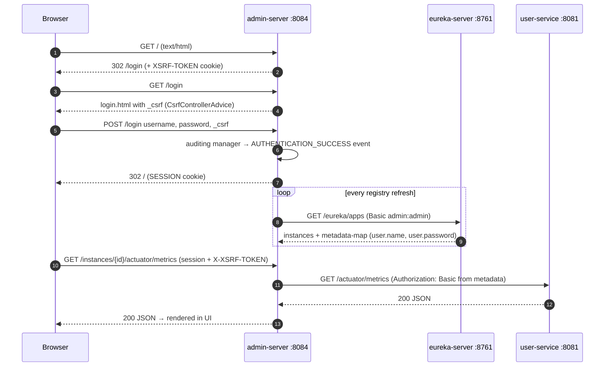
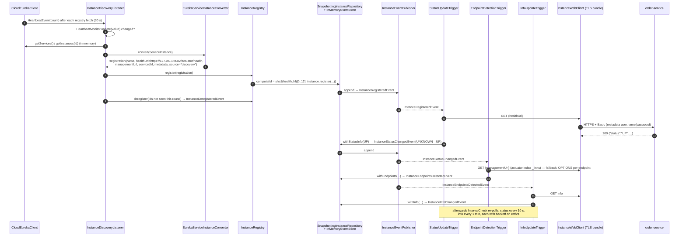
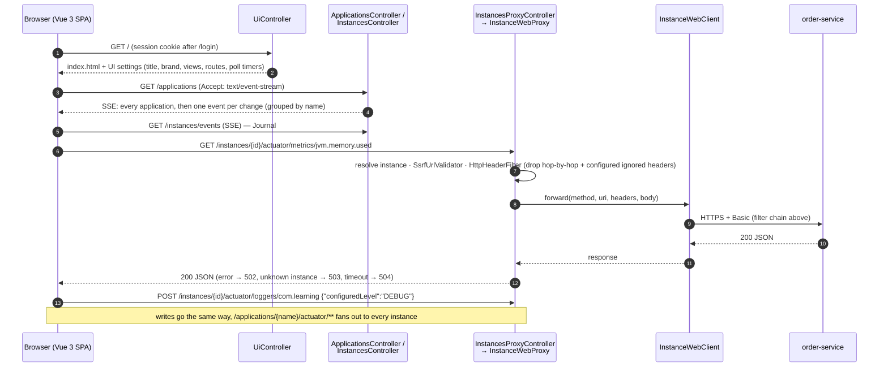
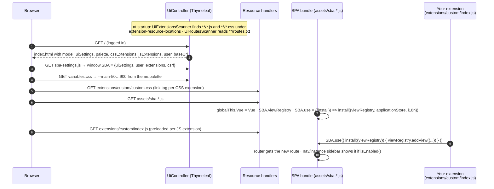

# <span style="color:hsl(201,80%,58%)">admin-server</span>

## <span style="color:hsl(151,80%,58%)">Table of contents</span>

1. 🧩 [Overview](#overview)
2. 🚀 [Run and log in](#run-and-login)
3. 🔐 [Security in detail](#security)
4. 🔑 [Types of supported security](#login-options)
5. 🔒 [HTTPS and mutual TLS to the registry and the services](#https)
6. 📡 [Actuator endpoints exposed](#actuator-endpoints)
7. ⏱️ [Quartz demo job](#quartz)
8. 📝 [Logging to file](#logging)
9. ⚙️ [Configuration reference](#configuration)
10. 🔄 [Polling frequency](#polling)
11. 🔬 [Internals: Spring Boot Admin 4.1 server and UI](#sba-internals)
    - 11.1 [Module map](#sba-internals-1)
    - 11.2 [Design](#sba-internals-2)
    - 11.3 [Discovery → registration → first status — sequence](#sba-internals-3)
    - 11.4 [The three polling loops](#sba-internals-4)
    - 11.5 [`InstanceWebClient` filter chain](#sba-internals-5)
    - 11.6 [UI ↔ server — sequence](#sba-internals-6)
    - 11.7 [Design patterns and principles in Spring Boot Admin](#sba-internals-7)
    - 11.8 [Tech stack: how the SBA server and UI are built](#sba-internals-8)
12. 🎨 [Customizing and extending the SBA UI](#ui-customization)
    - 12.1 [How the page is assembled](#ui-customization-1)
    - 12.2 [Level 1 — properties (`spring.boot.admin.ui.*`)](#ui-customization-2)
    - 12.3 [Theme, brand and your own images](#ui-customization-3)
    - 12.4 [Hiding built-in views](#ui-customization-4)
    - 12.5 [External views and per-instance flags](#ui-customization-5)
    - 12.6 [Level 2 — CSS extension](#ui-customization-6)
    - 12.7 [Level 3 — JS extension: your own views and instance tabs](#ui-customization-7)
    - 12.8 [Level 4 — replacing templates (last resort)](#ui-customization-8)
    - 12.9 [Checked against this module](#ui-customization-9)
    - 12.10 [Gotchas](#ui-customization-10)
13. 🧪 [Tests](#tests)
14. 🛠️ [Gotchas and troubleshooting](#gotchas)
15. ❓ [Q&A](#qa)
    - 15.1 [Does Spring Boot Admin poll, or do the clients push?](#qa-sba-poll-or-push)
    - 15.2 [If we don't use Eureka, do we have to list each client in SBA?](#qa-without-eureka)
    - 15.3 [So without Eureka it's a push from the client?](#qa-push-without-eureka)
    - 15.4 [Does Eureka save SBA from calling every instance, by replacing those calls with one call to Eureka?](#qa-eureka-saves-calls)
    - 15.5 [Can we avoid `spring-boot-admin-starter-client` in every service and rely on Eureka alone?](#qa-eureka-only)
    - 15.6 [What are the `AuditEventRepository` and `HttpExchangeRepository` beans in `ActuatorConfig` for?](#qa-actuator-repositories)
    - 15.7 [Can we use Basic auth to log in to the SBA UI but OAuth2 towards the backend services?](#qa-basic-ui-oauth-backend)
    - 15.8 🔥 [`SecurityConfig` exempts `/instances/**` and `/actuator/**` from CSRF — what does a malicious page do with a logged-in SBA session, and how narrow should the exemption be?](#qa-csrf-exemption-scope)
    - 15.9 🔥 [Someone clicks Heap Dump on a production `order-service` in SBA — what happens to that instance, its callers and the data?](#qa-heapdump-click-production)
    - 15.10 🔥 [Why is SBA a weak primary alerting system, even after you add a notifier?](#qa-sba-as-alerting)
    - 15.11 🔥🔥 [Run admin-server as two instances behind a load balancer — what breaks with this module's in-memory state, and is HA worth it at all?](#qa-sba-high-availability)
    - 15.12 🔥🔥 [SBA suddenly shows the three Postgres-backed services OFFLINE, while Eureka shows them UP and the gateway serves traffic — debug it](#qa-mass-offline-debug)

Spring Boot Admin (SBA) dashboard for the Eureka demo. Back to the project
overview: [../README.md](../README.md).

<a id="overview"></a>

## <span style="color:hsl(288,80%,58%)">1. 🧩 Overview</span>

- ***Role: a separate observer, not in the request path.*** It shows health,
  metrics, logs, environment, beans and so on for every instance registered in
  Eureka, and lets you act on them (change log levels, refresh, restart, shut down).
- ***Port `8084`, HTTPS only***, dashboard at https://localhost:8084 (import `certs/out/ca.crt` or click through).
- ***Reactive stack.*** The SBA 4 server starter runs on WebFlux/Netty, so
  everything here (security, filters, tests) is the reactive variant.
- ***Finds apps through Eureka, not by self-registration.*** With
  `spring-cloud-starter-netflix-eureka-client` on the classpath, SBA uses the
  Spring Cloud `DiscoveryClient` to list every service in the registry and turns
  each one into an SBA *instance*. The services don't need the SBA client library.
- ***It registers itself too.*** admin-server is a Eureka client (`eureka.client.service-url.defaultZone` →
  the registry nodes `localhost:8761`, `127.0.0.1:8762`, `127.0.0.2:8763`), so it appears in
  its own dashboard as `ADMIN-SERVER`, next to `EUREKA-SERVER`, `USER-SERVICE`,
  `ORDER-SERVICE`, `PRODUCT-SERVICE` and `GATEWAY-SERVICE`.
- ***Talks mutual TLS to the registry and to every service.*** Eureka client and SBA's `InstanceWebClient` both use
  the `service-identity` SSL bundle (trust the dev CA, present `CN=admin-server`), and the UI itself is served over
  HTTPS with the same bundle ([§5](#https)).
- Entry point: [AdminServerApplication.java](src/main/java/com/learning/discovery/admin/AdminServerApplication.java),
  annotated with `@EnableAdminServer` + `@SpringBootApplication`.

| Component         | Version (as of 2026)                        | Where it comes from    |
|-------------------|---------------------------------------------|------------------------|
| Java              | 27                                          | `super-pom` parent     |
| Spring Boot       | 4.1.2                                       | `super-pom` parent     |
| Spring Cloud      | 2025.1.x                                    | `super-pom` BOM import |
| Spring Boot Admin | 4.1.x (`spring-boot-admin-starter-server`)  | `super-pom` BOM import |
| Quartz            | Boot-managed (`spring-boot-starter-quartz`) | Boot BOM               |

Dependencies in [pom.xml](pom.xml):

| Dependency                                                                                   | Why                                                                                                             |
|----------------------------------------------------------------------------------------------|-----------------------------------------------------------------------------------------------------------------|
| `spring-boot-admin-starter-server`                                                           | the SBA server and Vue UI                                                                                       |
| `spring-cloud-starter-netflix-eureka-client`                                                 | discovery of instances + self-registration; also brings Spring Cloud Context (`restart`, `refresh`, `env` POST) |
| `spring-boot-starter-actuator`                                                               | admin-server's own actuator endpoints                                                                           |
| `spring-boot-starter-security`                                                               | login for the UI and actuator                                                                                   |
| `spring-boot-starter-quartz`                                                                 | demo job behind the SBA "Quartz" view                                                                           |
| `spring-boot-starter-test`, `spring-boot-webtestclient`, `spring-boot-starter-security-test` | integration test ([§13](#tests))                                                                                 |

- ***No Jolokia***: the pom comments it out on purpose. `jolokia-support-springboot`
  needs a servlet container, and this server is WebFlux only.

<a id="run-and-login"></a>

## <span style="color:hsl(66,80%,50%)">2. 🚀 Run and log in</span>

- ***Generate the TLS stores once*** (`./certs/generate-certs.sh`, root [§9](../README.md#https)) — the registry
  and order/product serve HTTPS only.
- ***Start `eureka-server` first.*** admin-server starts without it, but shows no
  applications until it can fetch the registry.
- From the repo root:

```bash
cd learning-spring-cloud
mvn -pl eureka-server spring-boot:run -Dspring-boot.run.profiles=peer1 &
mvn -pl eureka-server spring-boot:run -Dspring-boot.run.profiles=peer2 &   # once peer1 is up; peer3 optional
# wait for https://localhost:8761, then:
mvn -pl admin-server spring-boot:run
```

- ***IntelliJ***: run `AdminServerApplication` (its `main` is package-private
  and `static void main` with no `public`, which Java 25+ allows).
- Open https://localhost:8084. You are redirected to `/login`.
- ***Credentials: `admin` / `admin`.*** Override them with environment variables:

```bash
ACTUATOR_USER=ops ACTUATOR_PASSWORD='s3cret' mvn -pl admin-server spring-boot:run
```

- ***Use the same values for every module.*** The same user is used for the UI
  login, admin-server's own actuator, the Eureka registry URL, and the Basic
  auth SBA sends to each service. If they differ, instances show up as
  `OFFLINE` or never appear at all.

<a id="security"></a>

## <span style="color:hsl(31,80%,58%)">3. 🔐 Security in detail</span>

Everything lives in [SecurityConfig.java](src/main/java/com/learning/discovery/admin/config/SecurityConfig.java).
It is SBA's documented "secure the server" setup, rewritten for WebFlux.

### <span style="color:hsl(339,80%,58%)">3.1 Filter chain</span>

- ***A reactive `SecurityWebFilterChain`, with `@EnableWebFluxSecurity`.*** A
  servlet `SecurityFilterChain` would be silently ignored on Netty.
- ***The user store is Boot's default `ReactiveUserDetailsService`***, a
  single in-memory user built from `spring.security.user.*` (role `ACTUATOR`).
  It is wrapped in `UserDetailsRepositoryReactiveAuthenticationManager`, then in
  an auditing decorator ([§3.4](#security)).
- All paths are prefixed with `AdminServerProperties.path(...)`, so the setup
  keeps working if `spring.boot.admin.context-path` is ever set.

| Rule            | Paths                                             | Effect                                                                     |
|-----------------|---------------------------------------------------|----------------------------------------------------------------------------|
| `permitAll`     | `/assets/**`, `/variables.css`, `/login`          | the login page and its CSS/JS load before you log in                       |
| `permitAll`     | `/actuator/health/**`, `/actuator/info`, `/error` | probes and the Eureka/SBA status checks need no credentials                |
| `authenticated` | everything else                                   | UI, SBA REST API (`/applications`, `/instances`), other actuator endpoints |

| Mechanism        | Config                                                                           | Behaviour                                                                                                        |
|------------------|----------------------------------------------------------------------------------|------------------------------------------------------------------------------------------------------------------|
| ***Form login*** | `loginPage(/login)`, success → `RedirectServerAuthenticationSuccessHandler("/")` | browser requests (`Accept: text/html`) without a session get a `302` to `/login`; a successful login goes to `/` |
| ***Logout***     | `logoutUrl(/logout)`, success → `/login?logout`                                  | ends the session and shows SBA's "logged out" message                                                            |
| ***HTTP Basic*** | `httpBasic(...)` with the same auditing manager                                  | non-HTML clients (curl, JSON API) get a `401` + `WWW-Authenticate: Basic`                                        |

### <span style="color:hsl(116,80%,58%)">3.2 CSRF</span>

- ***The token is kept in a cookie the JS can read:***
  `CookieServerCsrfTokenRepository.withHttpOnlyFalse()` writes `XSRF-TOKEN`;
  the SBA Vue app (axios) sends it back as the `X-XSRF-TOKEN` header.
- ***`ServerCsrfTokenRequestAttributeHandler` (plain, not XOR-masked)***, so the raw cookie value is
  accepted as both header and `_csrf` form field, which is what the SBA UI sends.
- ***Exempt paths***, which are combined with `CsrfWebFilter.DEFAULT_CSRF_MATCHER` (so GET/HEAD/OPTIONS/TRACE
  are never checked):

| Exempt path                   | Why                                                                                      |
|-------------------------------|------------------------------------------------------------------------------------------|
| `/instances`, `/instances/**` | SBA clients self-register here with a plain POST, so there's no browser session or token |
| `/actuator/**`                | tooling and SBA calls with Basic auth (e.g. `POST /actuator/refresh`)                    |

- ***`csrfCookieWebFilter` bean.*** On WebFlux the CSRF token is a deferred
  `Mono<CsrfToken>`, and the cookie is only written if something subscribes to
  it. This lowest-precedence `WebFilter` subscribes on every request, so the SPA
  always has an `XSRF-TOKEN` cookie.
- ***[CsrfControllerAdvice.java](src/main/java/com/learning/discovery/admin/config/CsrfControllerAdvice.java).***
  SBA's Thymeleaf templates (`login.html`, `sba-settings.js`) read `${_csrf}`.
  Servlet security exposes that as a request attribute on its own; WebFlux does not.
  The `@ControllerAdvice` adds the `Mono<CsrfToken>` to the model as `_csrf`. ***Without it the login form posts with no
  token and gets a 403.***

### <span style="color:hsl(254,80%,58%)">3.3 Remember-me is disabled</span>

- ***Reactive Spring Security has no `rememberMe()`*** DSL, so there is nothing
  to back the checkbox.
- `spring.boot.admin.ui.remember-me-enabled: false` hides the checkbox in the
  SBA login page, so users aren't offered a feature that doesn't work.

### <span style="color:hsl(169,80%,58%)">3.4 Audit events for logins</span>

- ***Reactive security publishes no authentication events by default*** (the
  servlet `ProviderManager` does). So Boot's `AuthenticationAuditListener` would
  never see a login.
- `auditing(...)` wraps the manager with a `DefaultAuthenticationEventPublisher`:
  `doOnNext` → `publishAuthenticationSuccess`, `doOnError(AuthenticationException)`
  → `publishAuthenticationFailure`.
- The listener turns these into `AUTHENTICATION_SUCCESS` / `AUTHENTICATION_FAILURE`
  audit events, stored in the `InMemoryAuditEventRepository` from
  [ActuatorConfig.java](src/main/java/com/learning/discovery/admin/config/ActuatorConfig.java)
  and shown in SBA's "Audit Log" view (`/actuator/auditevents`).
- This covers both form logins and Basic logins, because both use the same wrapped manager.

### <span style="color:hsl(306,80%,58%)">3.5 How SBA authenticates to each service</span>

- Every service's actuator (except health/info) requires Basic auth, so SBA has
  to send credentials when it polls them.
- ***Per-instance metadata wins.*** SBA's `BasicAuthHttpHeaderProvider` reads
  `user.name` / `user.password` from the instance metadata. With Eureka that is
  each service's `eureka.instance.metadata-map`, which is copied into the
  registry and then into SBA. admin-server publishes its own metadata, because
  SBA discovers itself as well.
- ***Fallback: `spring.boot.admin.instance-auth`*** with `enabled: true` and
  `default-user-name` / `default-password` set to `spring.security.user.*`.
  This is used for any instance without metadata credentials.
- The header goes on every SBA→instance call: status polling, the endpoint
  detection probe, and the actuator calls the UI proxies (`/instances/{id}/actuator/**`).



<a id="login-options"></a>

## <span style="color:hsl(84,80%,58%)">4. 🔑 Types of supported security</span>

How *people* log into the dashboard. All of them must be the reactive variant,
because this is WebFlux.

| Option                                | How on WebFlux                                                                                                                                                                          | Notes                                                                                                                                             |
|---------------------------------------|-----------------------------------------------------------------------------------------------------------------------------------------------------------------------------------------|---------------------------------------------------------------------------------------------------------------------------------------------------|
| ***In-memory single user (current)*** | Boot's default from `spring.security.user.*`                                                                                                                                            | fine for a demo; one shared password, no per-person audit                                                                                         |
| Multiple in-memory users              | `MapReactiveUserDetailsService` bean with `User.withUsername(..).password(bcryptEncoder.encode(..))` + a `PasswordEncoder` bean (`BCryptPasswordEncoder` / `DelegatingPasswordEncoder`) | still in config, but gives per-person audit events and roles                                                                                      |
| Database users                        | custom `ReactiveUserDetailsService` backed by R2DBC (`spring-boot-starter-data-r2dbc`)                                                                                                  | stay fully non-blocking; JPA/JDBC would block the event loop                                                                                      |
| LDAP / Active Directory               | `ReactiveAuthenticationManagerAdapter` wrapping a blocking `LdapAuthenticationProvider` / `ActiveDirectoryLdapAuthenticationProvider`                                                   | ***blocking caveat***: the adapter runs it on `Schedulers.boundedElastic()`. That works, but it isn't truly reactive                              |
| ***OAuth2 / OIDC login***             | `spring-boot-starter-oauth2-client` + `http.oauth2Login(...)`; IdP: Keycloak, Okta, Microsoft Entra ID, Google, GitHub (GitHub is OAuth2 only, no OIDC)                                 | ***recommended for production***: SSO, MFA and group→role mapping are handled by the IdP. SBA's own `/login` page is replaced by the IdP redirect |
| SAML2                                 | `saml2Login()` exists for ***servlet only***                                                                                                                                            | ***not available on WebFlux***. Use OIDC, or put a SAML-capable proxy in front                                                                    |
| X.509 client certificates (mTLS)      | `server.ssl.client-auth=need` + `http.x509(...)`                                                                                                                                        | good for machine access or locked-down admin networks; awkward in browsers                                                                        |
| Remember-me                           | —                                                                                                                                                                                       | ***not on WebFlux*** (no reactive `rememberMe()`); use longer session timeouts or IdP SSO instead                                                 |

How *SBA* authenticates to each service:

| Option                                   | How                                                                                                                                                                                                                                                                                                                                  | Notes                                                                                                  |
|------------------------------------------|--------------------------------------------------------------------------------------------------------------------------------------------------------------------------------------------------------------------------------------------------------------------------------------------------------------------------------------|--------------------------------------------------------------------------------------------------------|
| ***Metadata Basic auth (current)***      | each service sets `eureka.instance.metadata-map.user.name/user.password`; `BasicAuthHttpHeaderProvider` sends it                                                                                                                                                                                                                     | simple, but the password sits in the Eureka registry, so anyone who can read `/eureka/apps` can see it |
| Per-service defaults                     | `spring.boot.admin.instance-auth.service-map.<service-name>.user-name/user-password`                                                                                                                                                                                                                                                 | keeps credentials out of the registry; they're configured centrally in admin-server                    |
| ***OAuth2 client credentials (bearer)*** | custom `HttpHeadersProvider` bean that gets a token through `ReactiveOAuth2AuthorizedClientManager` (client-credentials grant) and sets `Authorization: Bearer ...`; each service becomes a JWT resource server (`spring-boot-starter-oauth2-resource-server`, `http.oauth2ResourceServer(jwt())`) that requires an `actuator` scope | no shared passwords; tokens expire and can be revoked; per-service scopes                              |
| ***mTLS (current, alongside Basic)***    | `spring.http.clients.ssl.bundle` with a key store; each service allow-lists `CN=admin-server` in its `ClientCertificateSubjectFilter` ([§5](#https))                                                                                                                                                                                                                           | strongest transport identity; you have to run a certificate PKI                                        |

- ***Recommendation for production***: ***Keycloak (or any OIDC IdP) for
  dashboard login*** + ***OAuth2 client credentials*** for SBA→service calls.
  That gives one identity system, short-lived tokens, and no static passwords in
  Eureka metadata.

<a id="https"></a>

## <span style="color:hsl(45,80%,55%)">5. 🔒 HTTPS and mutual TLS to the registry and the services</span>

admin-server serves its UI and API over HTTPS (`:8084`, bundle `service-identity` via `app.tls.server-bundle`),
registers in Eureka as `https://127.0.0.1:8084`, and both of its outbound paths are mutual TLS: they present its own
certificate, `CN=admin-server,OU=learning-spring-cloud`, which every service allows. Whole-stack guide: root
[§9](../README.md#https).

| Outbound call                                   | Client                                   | TLS config                                                                 |
|-------------------------------------------------|------------------------------------------|----------------------------------------------------------------------------|
| Browser → UI/API (`https://localhost:8084`)      | Reactor Netty server                      | `server.ssl.bundle: ${app.tls.server-bundle}` (`service-identity`, `tls/identity.p12`), `client-auth: want`; plain `http://` connections are closed |
| Eureka client → registry (`https://…:8761-8763`) | `CloudEurekaClient`, RestClient transport | `app.tls.client-bundle` via [`EurekaClientTlsConfig`](src/main/java/com/learning/discovery/admin/config/EurekaClientTlsConfig.java) |
| SBA → each instance's actuator (itself included) | `InstanceWebClient` (Reactor Netty)       | `spring.http.clients.ssl.bundle: ${app.tls.client-bundle}` in [`application.yml`](src/main/resources/application.yml) |

- ***Why one property is enough for SBA*** — `AdminServerInstanceWebClientConfiguration` builds
  `InstanceWebClient.builder(webClient)` from the `WebClient.Builder` bean Boot auto-configures; Boot applies
  `spring.http.clients.*` (timeouts, redirects, ***SSL bundle***) to that builder's `ClientHttpConnector`. Status
  polling, endpoint detection, info polling and every proxied view (`/instances/{id}/actuator/**`) go through it.
  The bundle has a key store, so the connector also answers each service's certificate request with admin-server's
  certificate. HTTP targets (the gateway) are unaffected: the bundle only matters on a TLS handshake.
- ***Where the `https://` comes from*** — SBA never sees the target's `server.ssl`. `EurekaServiceInstanceConverter`
  takes the health URL from `InstanceInfo.secureHealthCheckUrl` (set when the target registers with
  `secure-port-enabled: true`) and the service/management URL from `EurekaServiceInstance.getUri()`, which is
  `https://host:securePort` for secure instances. So every service except the gateway shows an `https://` health
  URL in the instance list; the gateway keeps `http://`.
- ***Who may call admin-server: a WebFlux `ClientCertificateSubjectFilter`***. SBA 4 runs on Netty, so
  [the filter](src/main/java/com/learning/discovery/admin/config/ClientCertificateSubjectFilter.java) is a `WebFilter`
  (order `-110`, before Spring Security's `WebFilterChainProxy` at `-100`). It reads the client certificate from
  `ServerHttpRequest.getSslInfo().getPeerCertificates()` instead of the servlet attribute the other services use.
  Only `CN=admin-server,OU=learning-spring-cloud` is allowed: SBA polls its own actuator through its Eureka
  registration. Any other certificate (the gateway's, `dev-cli`) gets `403`. Browsers send no certificate and fall
  through to the login page.
- ***A 403 from a service looks like `DOWN`/`OFFLINE`***: if a service removes `CN=admin-server` from its
  `allowed-subjects`, SBA's health poll gets `403` and the instance turns red. The service's log has the
  `ClientCertificateSubjectFilter : 403 …` line.
- ***Trust failures look like `OFFLINE`*** — a handshake error is an exception in `StatusUpdater`, which maps
  exceptions to `OFFLINE` (not `DOWN`). Check the admin-server log for `PKIX path building failed` or
  `No subject alternative names`.
- ***The bundle trusts only the dev CA***: a target with a public certificate would fail; add its CA to
  `truststore.p12` (or use a PEM bundle with several certificates).

<a id="actuator-endpoints"></a>

## <span style="color:hsl(201,80%,58%)">6. 📡 Actuator endpoints exposed</span>

admin-server's own actuator endpoints. SBA shows them for the `ADMIN-SERVER`
instance, just as it does for the other services. All of them except
`health`/`info` need authentication.

| Endpoint                 | SBA view                                  | Backed by                                                                                                                                                                   |
|--------------------------|-------------------------------------------|-----------------------------------------------------------------------------------------------------------------------------------------------------------------------------|
| `health`                 | Details → Health (`show-details: always`) | Boot auto-config (Eureka, disk, ping, ...)                                                                                                                                  |
| `info`                   | Details → Info                            | Boot auto-config                                                                                                                                                            |
| `metrics`                | Details → Metrics, JVM, process           | Micrometer                                                                                                                                                                  |
| `env` (GET + ***POST***) | Environment (+ "Update" form)             | `management.endpoint.env.post.enabled: true`, Spring Cloud Context                                                                                                          |
| `refresh` (POST)         | Environment → "Refresh"                   | Spring Cloud Context; `access: unrestricted`; re-binds `@ConfigurationProperties` / `@RefreshScope`                                                                         |
| `restart` (POST)         | "Restart" button                          | Spring Cloud Context; `access: unrestricted`                                                                                                                                |
| `shutdown` (POST)        | "Shutdown" button                         | `access: unrestricted`                                                                                                                                                      |
| `loggers`                | Loggers (change levels at runtime)        | Boot auto-config                                                                                                                                                            |
| `logfile`                | Logfile                                   | `logging.file.name` ([§8](#logging))                                                                                                                                        |
| `heapdump`               | Heap Dump (download)                      | `access: unrestricted`; still behind login                                                                                                                                  |
| `threaddump`             | Thread Dump                               | Boot auto-config                                                                                                                                                            |
| `configprops`            | Configuration Properties                  | Boot auto-config                                                                                                                                                            |
| `beans`                  | Beans                                     | Boot auto-config                                                                                                                                                            |
| `mappings`               | Mappings                                  | Boot auto-config (WebFlux handler mappings)                                                                                                                                 |
| `httpexchanges`          | HTTP Exchanges                            | `InMemoryHttpExchangeRepository` bean in [ActuatorConfig.java](src/main/java/com/learning/discovery/admin/config/ActuatorConfig.java), recorded by `HttpExchangesWebFilter` |
| `startup`                | Startup                                   | `BufferingApplicationStartup(2048)` set in [AdminServerApplication.java](src/main/java/com/learning/discovery/admin/AdminServerApplication.java) `main`                     |
| `auditevents`            | Audit Log                                 | `InMemoryAuditEventRepository` bean + the login auditing in [§3.4](#security)                                                                                               |
| `sbom`                   | SBOM                                      | `META-INF/sbom/application.cdx.json` written by the `cyclonedx-maven-plugin` declared in the [root pom](../pom.xml)                                                         |
| `quartz`                 | Quartz                                    | `HeartbeatJob` ([§7](#quartz))                                                                                                                                              |

- ***`startup` exists only when started through `main`.*** `@SpringBootTest`
  doesn't call `main`, so the test context has no `BufferingApplicationStartup`
  and no `startup` endpoint.
- ***`sbom` needs a Maven build.*** The CycloneDX file is generated during the
  package lifecycle. Run `mvn package` (or `verify`) once if the view is empty.
- ***Why there's no `jolokia`***: the SBA 4 server is WebFlux only and
  `jolokia-support-springboot` needs a servlet container, so the SBA "JMX" view
  isn't available for admin-server. The servlet-based services can still offer it.
- ***`heapdump` is sensitive***: a heap dump contains secrets in memory (including
  the passwords above). Keep the port private, or drop it from the exposure list.
- ***`auditevents` and `httpexchanges` need a repository bean.*** Boot doesn't create one,
  so without the two beans in
  [ActuatorConfig.java](src/main/java/com/learning/discovery/admin/config/ActuatorConfig.java)
  both endpoints and their SBA views disappear. Both stores are in memory: see [Q6](#qa-actuator-repositories).

### Health probes, info and tags

- ***Probes*** — `management.endpoint.health.probes.enabled: true` adds public `/actuator/health/liveness` and
  `/actuator/health/readiness` (SBA Details → Health groups).
- ***Info*** — `info.app.*` (name, description, `tier: infra`, environment) plus the `java`, `os`, `process`
  contributors (`management.info.*.enabled`) → SBA Details → Info.
- ***Tags*** — `eureka.instance.metadata-map.tags.environment` (`APP_ENV`, default `local`) and `tags.tier: infra` →
  badges in SBA's application list.
- Custom health indicators and metrics live in [order-service](../order-service/README.md) only.

<a id="quartz"></a>

## <span style="color:hsl(13,80%,58%)">7. ⏱️ Quartz demo job</span>

- [QuartzConfig.java](src/main/java/com/learning/discovery/admin/job/QuartzConfig.java)
  declares a durable `JobDetail` `demo.heartbeatJob` and a `SimpleTrigger`
  `demo.heartbeatTrigger` that fires ***every minute, forever***.
- [HeartbeatJob.java](src/main/java/com/learning/discovery/admin/job/HeartbeatJob.java)
  extends `QuartzJobBean` and logs `Heartbeat from admin-server (fire time ...)`.
- It exists so the SBA ***Quartz*** view has something to show: jobs, triggers,
  next fire time. The scheduler is Boot's in-memory `RAMJobStore` (no JDBC store
  is configured).

```java

@Bean
Trigger heartbeatTrigger(JobDetail heartbeatJobDetail) {
    return TriggerBuilder.newTrigger()
            .forJob(heartbeatJobDetail)
            .withIdentity("heartbeatTrigger", "demo")
            .withSchedule(SimpleScheduleBuilder.repeatMinutelyForever())
            .build();
}
```

<a id="logging"></a>

## <span style="color:hsl(229,80%,58%)">8. 📝 Logging to file</span>

- `logging.file.name: logs/${spring.application.name}.log` → `logs/admin-server.log`,
  relative to the working directory. Running from the module directory puts it
  at `admin-server/logs/`; running from the repo root puts it at `logs/`.
- ***Setting a log file is what turns on `/actuator/logfile`***, and with it the
  SBA "Logfile" view. Without a file the endpoint returns 404.
- The heartbeat line ([§7](#quartz)) appears there once a minute, which is a
  quick way to check the Logfile view works.
- [banner.txt](src/main/resources/banner.txt) prints an "ADMIN SVC" ASCII banner at startup.

<a id="configuration"></a>

## <span style="color:hsl(271,80%,58%)">9. ⚙️ Configuration reference</span>

[application.yml](src/main/resources/application.yml), annotated:

<details><summary><b>application.yml — click to view</b></summary>

```yaml
spring:
  application:
    name: admin-server                     # Eureka app name ADMIN-SERVER; log file name
  security:
    user: # one user for the UI form login AND actuator Basic auth
      name: ${ACTUATOR_USER:admin}
      password: ${ACTUATOR_PASSWORD:admin}
      roles: ACTUATOR
  boot:
    admin:
      ui:
        remember-me-enabled: false         # no reactive rememberMe(); hide the checkbox
      instance-auth: # Basic auth SBA sends to each instance's actuator
        enabled: true                      # metadata user.name/user.password wins,
        default-user-name: ${spring.security.user.name}   # these are the fallback
        default-password: ${spring.security.user.password}

server:
  port: 8084

eureka:
  server:
    instances: [ localhost:8761, 127.0.0.1:8762, 127.0.0.2:8763 ]   # registry nodes, same list in every module
  client:
    service-url: # the registry itself is Basic-protected
      defaultZone: http://${…}@${eureka.server.instances[0]}/eureka/,http://${…}@${eureka.server.instances[1]}/eureka/,http://${…}@${eureka.server.instances[2]}/eureka/
  instance:
    lease-renewal-interval-in-seconds: 10      # heartbeat every 10 s (default 30)
    lease-expiration-duration-in-seconds: 30   # (default 90)
    prefer-ip-address: true                # register by IP, not hostname
    metadata-map: # SBA discovers itself, so it needs its own credentials
      user.name: ${spring.security.user.name}
      user.password: ${spring.security.user.password}

logging:
  file:
    name: logs/${spring.application.name}.log   # enables /actuator/logfile

management:
  endpoints:
    web:
      exposure:
        include: [ health, info, heapdump, logfile, env, shutdown, restart, refresh,
                   metrics, loggers, threaddump, configprops, beans, mappings,
                   httpexchanges, startup, auditevents, sbom, quartz ]
  endpoint:
    shutdown: { access: unrestricted }
    restart: { access: unrestricted }
    refresh: { access: unrestricted }
    env: { post: { enabled: true } }
    health: { show-details: always }
    heapdump: { access: unrestricted }
```

</details>

| Environment variable | Default | Used for                                                              |
|----------------------|---------|-----------------------------------------------------------------------|
| `ACTUATOR_USER`      | `admin` | UI login, actuator Basic, Eureka URL, metadata, instance-auth default |
| `ACTUATOR_PASSWORD`  | `admin` | same as above                                                         |

<a id="polling"></a>

## <span style="color:hsl(186,80%,50%)">10. 🔄 Polling frequency</span>

- ***Yes, it's configurable, but three separate loops refresh what you see***, each with its own setting. Property
  names and defaults come from the SBA 4.1.3 jar metadata (as of 2026). This module overrides none of them; see
  [application.yml](src/main/resources/application.yml).

```text
browser ──(1) ui.poll-timer.*, only while a detail view is open──► admin-server ──proxy──► instance /actuator/metrics…
browser ◄──── status changes pushed over SSE (no timer) ─────────── admin-server
                                                                   admin-server ──(2) monitor.*-interval──► instance /actuator/health, /info
                                                                   admin-server ◄──(3) Eureka registry fetch, 30 s── eureka-server
```

### <span style="color:hsl(339,80%,58%)">10.1 Browser → admin-server: detail views</span>

| Property (milliseconds)                      | Default | View          |
|----------------------------------------------|---------|---------------|
| `spring.boot.admin.ui.poll-timer.memory`     | 2500    | Memory        |
| `spring.boot.admin.ui.poll-timer.threads`    | 2500    | Threads       |
| `spring.boot.admin.ui.poll-timer.gc`         | 2500    | GC            |
| `spring.boot.admin.ui.poll-timer.process`    | 2500    | Process       |
| `spring.boot.admin.ui.poll-timer.cache`      | 2500    | Caches        |
| `spring.boot.admin.ui.poll-timer.datasource` | 2500    | Datasource    |
| `spring.boot.admin.ui.poll-timer.logfile`    | 1000    | Logfile       |
| `spring.boot.admin.ui.poll-timer.threaddump` | 1000    | Thread dump   |

- ***Runs only while the view is open in a browser.*** Each tick goes through admin-server's
  `/instances/{id}/actuator/**` proxy, so it's one actuator call on that instance per open tab.
- ***The application list and status badges have no timer.*** admin-server pushes status changes to the browser over
  server-sent events, so what they show is only as fresh as loop 2.

### <span style="color:hsl(116,80%,58%)">10.2 admin-server → each instance: status and info</span>

| Property                                       | Default | Meaning                                                                      |
|------------------------------------------------|---------|------------------------------------------------------------------------------|
| `spring.boot.admin.monitor.status-interval`    | 10 s    | How often `/actuator/health` is called; must be over 1 s                      |
| `spring.boot.admin.monitor.status-lifetime`    | 10 s    | Status isn't refreshed while the last one is unexpired; keep it = the interval |
| `spring.boot.admin.monitor.status-max-backoff` | 60 s    | Cap on the exponential back-off for an instance whose checks keep failing     |
| `spring.boot.admin.monitor.info-interval`      | 1 min   | How often `/actuator/info` is called                                         |
| `spring.boot.admin.monitor.info-lifetime`      | 1 min   | Same as status-lifetime, for info                                            |
| `spring.boot.admin.monitor.info-max-backoff`   | 10 min  | Back-off cap for info                                                        |
| `spring.boot.admin.monitor.default-timeout`    | 10 s    | Per-request timeout; `monitor.timeout.<endpoint>` overrides one endpoint      |
| `spring.boot.admin.monitor.default-retries`    | 0       | Retries per request; `monitor.retries.<endpoint>` overrides one endpoint      |

- ***Runs all the time, whether or not anyone is looking at the UI.*** Load is one health call per instance per
  interval ([Q4](#qa-eureka-saves-calls)).
- ***Lifetime longer than interval makes the lifetime the real interval***, because polls inside it are skipped.

### <span style="color:hsl(254,80%,58%)">10.3 Discovery: new and removed instances</span>

- ***Not an SBA property.*** admin-server re-reads its instance list each time its Eureka client fetches the registry
  ([Q1](#qa-sba-poll-or-push)), so the setting is `eureka.client.registry-fetch-interval-seconds` (default 30) in this
  module's `application.yml`.
- A new instance can take longer than 30 s to show, because eureka-server's own response cache adds to the fetch delay.

### <span style="color:hsl(31,80%,58%)">10.4 Tuning it</span>

```yaml
spring:
  boot:
    admin:
      monitor:
        status-interval: 30s     # fewer health calls to every instance
        status-lifetime: 30s
        timeout:
          health: 3s             # fail fast instead of the 10 s default
      ui:
        poll-timer:
          memory: 5000           # slower detail views
          threads: 5000
```

| Change                       | You gain                                                   | You pay                                                                                        |
|------------------------------|------------------------------------------------------------|------------------------------------------------------------------------------------------------|
| Longer `status-interval`     | Fewer `/actuator/health` calls, which run every indicator (`db`, `ordersCache`…) | DOWN/OFFLINE shows, and notifies, later ([Q10](#qa-sba-as-alerting))                     |
| Shorter `status-interval`    | Faster detection                                           | N instances ÷ interval health calls; slow indicators can pile up ([Q12](#qa-mass-offline-debug)) |
| Shorter `timeout.health`     | Hung instances go OFFLINE sooner                           | A slow-but-alive DB indicator flips instances to OFFLINE                                        |
| Longer `ui.poll-timer.*`     | Less load from open tabs                                   | Charts update less smoothly; cost only exists while someone has a view open                     |
| Shorter fetch interval       | New instances appear sooner                                | More registry fetches from eureka-server (deltas, cheap)                                        |

- ***Worst-case detection with the defaults ≈ interval + timeout = 20 s***: the instance hangs right after a check,
  the next check starts 10 s later, and it gives up after another 10 s.

<a id="sba-internals"></a>

## <span style="color:hsl(270,70%,62%)">11. 🔬 Internals: Spring Boot Admin 4.1 server and UI</span>

Read from the `spring-boot-admin-server` and `spring-boot-admin-server-cloud` 4.1.3 sources. Three ideas carry the
whole design: ***discovery turns registry entries into `Registration`s***, the ***instance is an event-sourced
aggregate***, and ***everything else reacts to the event stream***.

<a id="sba-internals-1"></a>

### 11.1 Module map

| Module / package                          | Key types                                                                                                   | Job                                                                         |
|-------------------------------------------|-------------------------------------------------------------------------------------------------------------|-----------------------------------------------------------------------------|
| `server-cloud` `…cloud.discovery`         | `InstanceDiscoveryListener`, `EurekaServiceInstanceConverter`, `DefaultServiceInstanceConverter`            | Spring Cloud `DiscoveryClient` → SBA registrations                          |
| `server` `…services`                      | `InstanceRegistry`, `HashingInstanceUrlIdGenerator`, `StatusUpdater`(`Trigger`), `EndpointDetector`(`Trigger`), `InfoUpdater`(`Trigger`), `IntervalCheck` | register/deregister, the three polling loops |
| `server` `…domain.entities` / `.events` / `.values` | `Instance`, `EventsourcingInstanceRepository`, `SnapshottingInstanceRepository`; `InstanceRegisteredEvent`, `InstanceStatusChangedEvent`, `InstanceEndpointsDetectedEvent`, `InstanceInfoChangedEvent`, `InstanceRegistrationUpdatedEvent`, `InstanceDeregisteredEvent`; `Registration`, `StatusInfo`, `Endpoints`, `Info`, `Tags` | the domain model |
| `server` `…eventstore`                    | `InstanceEventStore`, `InMemoryEventStore` (`ConcurrentMapEventStore`), `HazelcastEventStore`, `InstanceEventPublisher` | append-only event log + Reactor fan-out                       |
| `server` `…web.client`                    | `InstanceWebClient`, `InstanceExchangeFilterFunctions`, `BasicAuthHttpHeaderProvider`, `LegacyEndpointConverters` | the HTTP client to instances, with its filter chain                 |
| `server` `…web`                           | `ApplicationsController`, `InstancesController`, `InstancesProxyController`, `InstanceWebProxy`, `SsrfUrlValidator` | REST + SSE API for the UI, actuator proxy                          |
| `server` `…notify`                        | `Notifier` implementations (mail, Slack, Teams, …), `FilteringNotifier`                                     | react to status changes (none configured here)                              |
| `server-ui`                               | `UiController`, `AdminServerUiAutoConfiguration`, Vue 3 SPA under `META-INF/spring-boot-admin-server-ui`     | serves the single-page UI and its settings                                  |

<a id="sba-internals-2"></a>

### 11.2 Design

```mermaid
classDiagram
    direction LR
    class InstanceDiscoveryListener {
        -HeartbeatMonitor monitor
        onApplicationReady / onInstanceRegistered / onHeartbeat(HeartbeatEvent)
        #discover()
        #removeStaleInstances(ids)
    }
    class EurekaServiceInstanceConverter {
        convert(ServiceInstance) Registration
        getHealthUrl() secureHealthCheckUrl ?: healthCheckUrl
    }
    class InstanceRegistry {
        register(Registration) Mono~InstanceId~
        deregister(InstanceId)
    }
    class Instance {
        <<aggregate, immutable>>
        InstanceId id
        long version
        Registration registration
        StatusInfo statusInfo
        Endpoints endpoints
        Info info
        List~InstanceEvent~ unsavedEvents
        register() / withStatusInfo() / withEndpoints() / withInfo() / deregister()
    }
    class SnapshottingInstanceRepository {
        -ConcurrentMap~InstanceId, Instance~ snapshots
        compute(id, fn) with optimistic-lock retry
    }
    class InMemoryEventStore {
        append(List~InstanceEvent~) — version check
        find(id) Flux~InstanceEvent~
    }
    class InstanceEventPublisher {
        Sinks.many().unicast() → publish().autoConnect(0)
    }
    class StatusUpdateTrigger
    class EndpointDetectionTrigger
    class InfoUpdateTrigger
    class InstanceWebClient {
        filters: headers, rewrite URL, accept, legacy, logfile, cookies, retry, timeout
    }
    InstanceDiscoveryListener --> EurekaServiceInstanceConverter
    InstanceDiscoveryListener --> InstanceRegistry
    InstanceRegistry --> SnapshottingInstanceRepository
    SnapshottingInstanceRepository --> InMemoryEventStore
    InMemoryEventStore --|> InstanceEventPublisher
    SnapshottingInstanceRepository ..> Instance
    InstanceEventPublisher ..> StatusUpdateTrigger : events
    InstanceEventPublisher ..> EndpointDetectionTrigger : events
    InstanceEventPublisher ..> InfoUpdateTrigger : events
    StatusUpdateTrigger --> InstanceWebClient : GET health
    EndpointDetectionTrigger --> InstanceWebClient : GET /actuator, OPTIONS
    InfoUpdateTrigger --> InstanceWebClient : GET info
```



- ***Instance id*** — `HashingInstanceUrlIdGenerator`: the first 12 hex characters of `SHA-1(healthUrl)`. The id is
  stable across SBA restarts as long as the health URL is; when an instance switches from `http://` to `https://`
  (as order/product did) it gets a ***new id***, and the old one is deregistered as stale.
- ***Event sourcing*** — `Instance` never mutates: each `withX(...)` returns a copy with one more entry in
  `unsavedEvents` (only if something actually changed). `repository.save` appends those events with the aggregate's
  `version`; a concurrent writer causes `OptimisticLockingException`, and `compute` retries on the fresh state. The
  in-memory store keeps at most `maxLogSizePerAggregate` (100) events per instance — that is the history the UI's
  *Journal* shows, and why it's empty after an SBA restart.
- ***One hot stream*** — `InstanceEventPublisher` emits every appended event into a unicast sink shared through
  `publish().autoConnect(0)`; each trigger, the snapshot cache, notifiers and every UI SSE connection subscribe to it.

<a id="sba-internals-3"></a>

### 11.3 Discovery → registration → first status — sequence



<a id="sba-internals-4"></a>

### 11.4 The three polling loops

| Loop                      | Starts on                                                                 | Interval (`spring.boot.admin.monitor.*`)                      | Result → event                                                               |
|---------------------------|---------------------------------------------------------------------------|---------------------------------------------------------------|------------------------------------------------------------------------------|
| `StatusUpdateTrigger`     | `InstanceRegisteredEvent`, `InstanceRegistrationUpdatedEvent` + interval  | `status-interval` 10 s, `status-lifetime` 10 s, `status-max-backoff` 60 s | body `status` → `UP`/`DOWN`/…; non-2xx without a body → `DOWN`; exception/timeout → `OFFLINE` → `InstanceStatusChangedEvent` |
| `EndpointDetectionTrigger`| `InstanceStatusChangedEvent`, `InstanceRegistrationUpdatedEvent`           | event-driven only                                             | `QueryIndexEndpointStrategy` (actuator index) then `ProbeEndpointsStrategy` (OPTIONS) → `InstanceEndpointsDetectedEvent` |
| `InfoUpdateTrigger`       | `InstanceEndpointsDetectedEvent`, `InstanceStatusChangedEvent`, `InstanceRegistrationUpdatedEvent` + interval | `info-interval` 1 min, `info-lifetime` 1 min, `info-max-backoff` 10 min | `/actuator/info` → `InstanceInfoChangedEvent`                                |

`IntervalCheck` drives the periodic part: every interval it checks each instance whose last check is older than the
lifetime, and doubles the per-instance delay after failures up to the max backoff. The rates and tuning knobs are in
[§10](#polling).

<a id="sba-internals-5"></a>

### 11.5 `InstanceWebClient` filter chain

Every request to an instance — polling and proxied UI calls — runs through these `InstanceExchangeFilterFunction`s,
in `@Order`:

| Order | Filter                         | Does                                                                                      |
|-------|--------------------------------|-------------------------------------------------------------------------------------------|
| 0     | `addHeaders`                   | `HttpHeadersProvider`s, here `BasicAuthHttpHeaderProvider`: Basic from metadata `user.name`/`user.password`, else `instance-auth.default-*` ([§3.5](#security)) |
| 10    | `rewriteEndpointUrl`           | turns a relative endpoint id (`health`, `info`, `metrics`) into the instance's absolute URL from its `Endpoints` |
| 20    | `setDefaultAcceptHeader`       | actuator v3/v2 media types + JSON                                                         |
| 30    | `convertLegacyEndpoints`       | Boot 1.x responses → current format                                                       |
| 40    | `logfileAcceptWorkaround`      | `Accept: */*` for `logfile`                                                               |
| 50    | `handleCookies`                | per-instance cookie store (session-based actuators)                                       |
| 100   | `retry`                        | `spring.boot.admin.monitor.default-retries` (0) / per endpoint                            |
| 200   | `timeout`                      | `spring.boot.admin.monitor.default-timeout` (10 s) / per endpoint                         |

The connector underneath is Boot's (`spring.http.clients.*`), which is where the TLS bundle plugs in ([§5](#https)).

<a id="sba-internals-6"></a>

### 11.6 UI ↔ server — sequence



- ***The UI only talks to admin-server*** — never to an instance; that is why only admin-server needs network access
  to (and trust in) the services, and why its Basic credentials/metadata are the security boundary ([§3](#security)).
- ***Live updates are SSE***, not polling from the browser: the server's polling loops (11.4) produce events, and
  the SSE endpoints stream them. A proxy that buffers responses (or a too-short idle timeout) freezes the dashboard.

<a id="sba-internals-7"></a>

### 11.7 Design patterns and principles in Spring Boot Admin

| Pattern / principle | Where (SBA 4.1.3) | What it buys |
|---|---|---|
| ***Event Sourcing*** | `Instance` is rebuilt from `InstanceEvent`s; `EventsourcingInstanceRepository` appends to `InstanceEventStore` (`InMemoryEventStore`, `HazelcastEventStore`) | full history per instance (the *Journal*), replay after a cluster node joins, no in-place mutation |
| ***Immutable aggregate*** | every `Instance.withX(...)` returns a copy with one more `unsavedEvent`, or `this` when nothing changed | thread-safe sharing of instance state across reactive pipelines |
| ***Optimistic concurrency*** | aggregate `version` checked on append (`OptimisticLockingException`); `repository.compute(...)` retries on fresh state | concurrent pollers and discovery updates never lose each other's events |
| ***Snapshot (memento cache)*** | `SnapshottingInstanceRepository` keeps the latest `Instance` per id, invalidates on lock conflicts | O(1) reads for the UI without replaying the event log |
| ***Publish–subscribe (reactive)*** | `InstanceEventPublisher`: `Sinks.many().unicast()` → `publish().autoConnect(0)`; subscribers extend `AbstractEventHandler` | triggers, notifiers, snapshot cache and SSE clients decouple completely ([11.4](#sba-internals-4)) |
| ***Reactor (event-driven) triggers*** | `StatusUpdateTrigger`, `EndpointDetectionTrigger`, `InfoUpdateTrigger` react to specific event types; `IntervalCheck` adds periodic re-checks | work happens because something changed, plus a heartbeat for drift |
| ***Chain of Responsibility (filters)*** | `InstanceExchangeFilterFunction`s ordered 0–200 on `InstanceWebClient` ([11.5](#sba-internals-5)) | auth, URL rewriting, legacy conversion, retry and timeout as independent links |
| ***Strategy*** | `EndpointDetectionStrategy` (`QueryIndexEndpointStrategy`, `ProbeEndpointsStrategy`, `ChainingStrategy` as a composite), `InstanceIdGenerator`, `ServiceInstanceConverter` (`Eureka…`, `Kubernetes…`, `Default…`), `HttpHeadersProvider`, `Notifier` | each concern swappable by declaring a bean |
| ***Adapter*** | `ServiceInstanceConverter` turns a Spring Cloud `ServiceInstance` into an SBA `Registration`; `LegacyEndpointConverters` adapt Boot 1.x actuator payloads | one internal model regardless of discovery source or client generation |
| ***Decorator*** | `FilteringNotifier` wraps a `Notifier` with `NotificationFilter`s; `CompositeHttpHeadersProvider` | add behaviour to notifiers/headers without subclassing |
| ***Proxy (reverse proxy)*** | `InstancesProxyController` → `InstanceWebProxy` → `InstanceWebClient`; `SsrfUrlValidator`, `HttpHeaderFilter` | the browser never reaches services; credentials and TLS stay server-side ([11.6](#sba-internals-6)) |
| ***Exponential backoff*** | `IntervalCheck` per-instance delay doubling up to `status-max-backoff` / `info-max-backoff` | a sick instance isn't hammered every 10 s |
| ***Content hashing for identity*** | `HashingInstanceUrlIdGenerator`: first 12 hex chars of `SHA-1(healthUrl)` | stable ids across restarts without a database |
| ***Plugin architecture (UI)*** | `SBA.use({install})` + `viewRegistry.addView`, extensions discovered by classpath scanning ([12.7](#ui-customization-7)) | new views without forking the UI |

***Principles behind the code***

- ***Observer, not participant*** — SBA only reads registries and polls actuators; nothing in the request path
  depends on it, so it can be down without user impact.
- ***Reactive all the way*** — WebFlux server, Reactor pipelines, SSE to the browser: thousands of polls run on a
  handful of event-loop threads.
- ***Everything is a bean*** — every strategy above is `@ConditionalOnMissingBean`, so customization means declaring
  one bean, not patching SBA.

<a id="sba-internals-8"></a>

### 11.8 Tech stack: how the SBA server and UI are built

Read from the 4.1.3 artifacts: the server POMs, and the UI jar's `META-INF/spring-boot-admin-server-ui/` assets,
whose ***source maps*** list every bundled npm package (`assets/*.js.map`).

***Server*** (`spring-boot-admin-server`, `-server-cloud`)

| Concern | Technology |
|---|---|
| Language / build | Java 17+ baseline, Maven, Spring Boot auto-configuration (`AdminServerAutoConfiguration`, …) |
| Web | ***Spring WebFlux*** + ***Project Reactor*** (`reactor-extra`); a Servlet/MVC variant exists (`web.servlet.InstancesProxyController`); this repo uses WebFlux |
| HTTP to instances | `WebClient` (`spring-boot-starter-webclient`, Reactor Netty), wrapped as `InstanceWebClient` ([11.5](#sba-internals-5)) |
| UI page rendering | ***Thymeleaf*** (`spring-boot-starter-thymeleaf`) renders `index.html`, `login.html`, `sba-settings.js`, `variables.css` ([12.1](#ui-customization-1)) |
| Clustering (optional) | ***Hazelcast*** event store (`HazelcastEventStore`) — not used here, in-memory store instead |
| Notifications (optional) | `spring-boot-starter-mail` + webhook notifiers (Slack, Teams, …) |
| JSON | Jackson (`AdminServerModule`, mixins, sanitizing serializers) |

***UI*** (`spring-boot-admin-server-ui`) — compiled when SBA is released; the jar holds only the built, hashed
bundles (`assets/sba-*.js`, `*.css`) plus source maps, so no Node.js is needed to use or customize it.

| Concern | Technology (from the source maps) |
|---|---|
| Framework | ***Vue 3*** — 167 single-file components (`.vue`) and 73 TypeScript modules; `globalThis.Vue` is exposed for extensions |
| Language / build | ***TypeScript***, built with ***Vite*** (hashed chunks, `__vite-browser-external`) |
| Styling | ***Tailwind CSS 4.3.3*** (+ PostCSS), ***PrimeVue 4*** components with `@primeuix/themes`, ***Headless UI*** (`@headlessui/vue`), ***Font Awesome*** icons (`@fortawesome/*`) |
| Routing / i18n | `vue-router` (views registered through `viewRegistry`), `vue-i18n` (`@intlify/*`) + `primelocale` |
| HTTP / live data | ***axios*** (+ `qs`) for REST and the actuator proxy, ***RxJS*** for polling streams, `event-source-polyfill` for SSE (`/applications`, `/instances/events`) |
| Charts / wallboard | ***Chart.js*** (+ `chartjs-adapter-moment`) and ***D3*** (`d3-shape`, `d3-scale`, `d3-selection`, `d3-hierarchy`, `d3-transition`, …) |
| Dates / formatting | `moment`, `dayjs`, `pretty-bytes`, `iso8601-duration`, `cronstrue` (human-readable cron for the scheduled-tasks view) |
| Content rendering | `sanitize-html`, `autolinker`, `ansi_up` (coloured log file view), `js-yaml` |
| Utilities | `lodash-es`, `fuse.js` (search), `file-saver` (heap/thread dump downloads), `@vueuse/core`, `mitt` (event bus), `nanoid`, `v3-infinite-loading`, a toast notification center |

- ***Why it matters for extensions*** — custom views run inside this Vue 3 app: use the global `Vue` (never bundle a
  second copy) and the `SBA.use` API; Tailwind/PrimeVue classes are visible to your components but are not a stable
  API ([12.7](#ui-customization-7), [12.10](#ui-customization-10)).
- ***Why it matters for security*** — the UI is a static SPA; every data call goes to admin-server (`/applications`,
  `/instances/**`), never to a service directly ([11.6](#sba-internals-6)).

<a id="ui-customization"></a>

## <span style="color:hsl(320,70%,60%)">12. 🎨 Customizing and extending the SBA UI</span>

The SBA 4.1 UI is a Vue 3 single-page app inside `spring-boot-admin-server-ui`. You don't fork it — there are four
levels, from no code to full replacement, all checked against the 4.1.3 jar (`AdminServerUiProperties`,
`UiController`, `UiExtensionsScanner`, `UiRoutesScanner`, the bundled `index.html` / `sba-settings.js` /
`variables.css`, and the SPA bundle's `SBA` global).

| Level | What                                              | Effort        | Survives upgrades |
|-------|---------------------------------------------------|---------------|-------------------|
| 1     | `spring.boot.admin.ui.*` properties: title, brand, theme, hidden views, external links, polling | YAML          | ✅                 |
| 2     | CSS extension: override colours/CSS variables     | one `.css`    | mostly (CSS classes can change) |
| 3     | JS extension: new top-level pages, new instance tabs, redirects | JS / Vue      | ✅ (public `SBA.use` API) |
| 4     | Replace templates or static assets                | copy + edit   | ❌ (tied to one UI build) |

<a id="ui-customization-1"></a>

### 12.1 How the page is assembled



- ***Static files*** — `/**` is served from `spring.boot.admin.ui.resource-locations`
  (default `classpath:/META-INF/spring-boot-admin-server-ui/`), `/extensions/**` from
  `extension-resource-locations` (default `classpath:/META-INF/spring-boot-admin-server-ui/extensions/`, scanned as
  `classpath*:`, so extensions can come from any jar on the classpath).
- ***Deep links*** — the `HomepageForwardingFilter` forwards UI routes (`/about/**`, `/applications/**`,
  `/instances/**`, `/journal/**`, `/wallboard/**`, `/external/**`, plus every line of every `routes.txt`) to
  `index.html`, so a browser refresh on a client-side route doesn't 404.

<a id="ui-customization-2"></a>

### 12.2 Level 1 — properties (`spring.boot.admin.ui.*`)

| Property                              | Default                                    | Effect                                                                 |
|---------------------------------------|--------------------------------------------|------------------------------------------------------------------------|
| `title`                               | `Spring Boot Admin`                        | `<title>` of UI and login page                                         |
| `brand`                               | SBA logo + text (HTML)                     | top-left of the nav bar; raw HTML                                      |
| `login-icon`                          | `assets/img/icon-spring-boot-admin.svg`    | image on the login page                                                |
| `favicon` / `favicon-danger`          | `assets/img/favicon.png` / `…-danger.png`  | the danger icon is shown while any instance is down                    |
| `theme.color`                         | `#14615A`                                  | `<meta name="theme-color">`                                            |
| `theme.palette.shade50` … `shade900`  | teal scale                                 | `--main-50` … `--main-900` in `variables.css` (all accents)            |
| `theme.background-enabled`            | `true`                                     | the gradient background                                                |
| `view-settings[n].name` / `.enabled`  | all on                                     | hide a built-in view (12.4)                                            |
| `external-views[n].label/url/order/iframe/children` | none                         | extra nav entries: link, iframe, or dropdown                           |
| `poll-timer.{cache,datasource,gc,process,memory,threads}` | `2500` ms                | refresh rate of the live charts on the Details/Metrics views           |
| `poll-timer.{threaddump,logfile}`     | `1000` ms                                  | refresh of thread dump / log tail                                      |
| `available-languages`                 | all bundled                                | language picker, e.g. `[en, de]`                                       |
| `enable-toasts`                       | `false`                                    | in-page toast on status changes                                        |
| `browser-notification-timeout`        | `5s`                                       | desktop notification duration                                          |
| `hide-instance-url` / `disable-instance-url` | `false`                             | hide / don't link the instance URL in lists                            |
| `remember-me-enabled`                 | `true` (`false` here)                      | "remember me" checkbox on the login page                               |
| `public-url`                          | context path                               | external base URL when SBA sits behind a proxy (`<base href>`)         |
| `cache.max-age` / `no-cache` / `no-store` | `3600s` / `false` / `false`            | `Cache-Control` on UI resources (extensions included)                  |
| `cache-templates`                     | `true`                                     | Thymeleaf template cache (turn off while editing templates)            |
| `additional-route-excludes`           | none                                       | paths the homepage forwarder must not swallow                          |
| `resource-locations` / `extension-resource-locations` / `template-location` | the jar | where static files, extensions and templates come from     |

Example for this module (not applied — copy into [application.yml](src/main/resources/application.yml) under
`spring.boot.admin.ui`):

```yaml
spring:
  boot:
    admin:
      ui:
        title: Learning Spring Cloud — Admin
        brand: '<span>Learning Admin</span>'
        theme:
          color: "#4F46E5"
          palette:            # indigo instead of teal; any 10-step scale works
            shade50: "#EEF2FF"
            shade100: "#E0E7FF"
            shade200: "#C7D2FE"
            shade300: "#A5B4FC"
            shade400: "#818CF8"
            shade500: "#6366F1"
            shade600: "#4F46E5"
            shade700: "#4338CA"
            shade800: "#3730A3"
            shade900: "#312E81"
        view-settings:
          - name: instances/heapdump     # hide the view (see the warning in 15.4)
            enabled: false
          - name: instances/jolokia
            enabled: false
        external-views:
          - label: Eureka
            url: https://localhost:8761
            order: 2000
          - label: Tracing
            children:
              - label: Zipkin
                url: http://localhost:9411/zipkin/
              - label: Grafana
                url: http://localhost:3000
                iframe: true
        enable-toasts: true
        available-languages: [en, de]
        poll-timer:
          memory: 5000
          threads: 5000
```

<a id="ui-customization-3"></a>

### 12.3 Theme, brand and your own images

- ***Colours*** — the palette ends up as `--main-50` … `--main-900` in `variables.css` (values rendered as
  `rgb(r, g, b)`); every accent in the SPA uses those variables, so `theme.palette` restyles the whole UI.
- ***Your own logo/favicon*** — put files on a resource location and reference them relatively. Either add a location
  (the jar's must stay first, or you shadow the UI itself):

  ```yaml
  spring.boot.admin.ui:
    resource-locations: classpath:/META-INF/spring-boot-admin-server-ui/,classpath:/sba-branding/
    brand: '<span>Learning Admin</span>'
    favicon: favicon.png
    login-icon: logo.svg
  ```

  …or ship them under `src/main/resources/META-INF/spring-boot-admin-server-ui/assets/img/`, which the default
  location already serves.
- ***Security*** — the login page is rendered ***before*** authentication: [SecurityConfig](src/main/java/com/learning/discovery/admin/config/SecurityConfig.java)
  permits only `/assets/**`, `/variables.css` and `/login` (plus the public paths). A `login-icon` or `favicon`
  outside `assets/` shows as a broken image on the login page; keep login-page images under `assets/` or permit
  their path. Extensions (`/extensions/**`) load only after login, so they can stay authenticated.

<a id="ui-customization-4"></a>

### 12.4 Hiding built-in views

`view-settings` takes the view ***name***. The ones in 4.1.3:

| Area      | Names                                                                                                                                                                                                                                                                                     |
|-----------|-------------------------------------------------------------------------------------------------------------------------------------------------------------------------------------------------------------------------------------------------------------------------------------------|
| Top level | `applications`, `wallboard`, `journal`, `about`                                                                                                                                                                                                                                           |
| Instance  | `instances/details`, `metrics`, `env`, `beans`, `configprops`, `conditions`, `scheduledtasks`, `caches`, `flyway`, `liquibase`, `startup`, `loggers`, `logfile`, `jolokia`, `threaddump`, `heapdump`, `httpexchanges`, `httptrace`, `auditevents`, `sessions`, `mappings`, `gateway`, `quartz`, `sbom`, `dependencies` (all prefixed `instances/`) |

- ***It only hides the UI*** — the default `isEnabled` of every view checks `uiSettings.viewSettings`; the
  endpoint itself is still exposed by the service and still reachable through SBA's proxy
  (`/instances/{id}/actuator/heapdump`) by anyone logged in. To really block it, drop it from
  `management.endpoints.web.exposure.include` in the service, or deny the path in this module's `SecurityConfig`
  (see [Q&A 15.9](#qa-heapdump-click-production)).
- ***Built-in views also hide themselves*** when the instance lacks the endpoint
  (`isEnabled: ({instance}) => instance.hasEndpoint('heapdump')`) — that's why `gateway` appears only for
  `GATEWAY-SERVICE` and `sessions` only for `ORDER-SERVICE`.

<a id="ui-customization-5"></a>

### 12.5 External views and per-instance flags

- ***External views*** — `url` + `label` makes a nav link (opens a new tab); `iframe: true` embeds it under
  `/external/...`, which only works if the target allows framing. Spring Security sends `X-Frame-Options: DENY` by
  default, so the Eureka dashboard and the other modules' pages need `iframe: false`; `children` turns an entry into
  a dropdown; `order` sorts them among the built-in entries.
- ***Per-instance metadata*** (set in the service's `eureka.instance.metadata-map`, read by the UI):
  - `tags.*` — badges in the application list (already used: `tags.environment`, `tags.tier`).
  - `hide-url: "true"` / `disable-url: "true"` — hide or un-link that instance's URL (per-instance version of
    `hide-instance-url` / `disable-instance-url`).

<a id="ui-customization-6"></a>

### 12.6 Level 2 — CSS extension

Any `.css` under the extension location is linked into `index.html` after the UI's own styles:

```css
/* src/main/resources/META-INF/spring-boot-admin-server-ui/extensions/custom/custom.css */
:root {
  --main-500: rgb(99, 102, 241);   /* same variables variables.css defines; wins by load order */
}
.navbar { box-shadow: none; }      /* SPA classes are not an API: re-check after upgrades */
```

Prefer `theme.palette` for colours; use CSS for what properties can't express. The login page doesn't load
extension CSS.

<a id="ui-customization-7"></a>

### 12.7 Level 3 — JS extension: your own views and instance tabs

***Layout*** (in this module, no extra dependency):

```text
src/main/resources/META-INF/spring-boot-admin-server-ui/extensions/custom/
├── index.js        # loaded on every UI page; calls SBA.use(...)
├── custom.css      # optional
└── routes.txt      # one client-side route per line, e.g. /custom  (deep-link refresh)
```

At startup the log shows `Loaded Spring Boot Admin UI Extension: UiExtension(resourcePath=custom/index.js, …)`.

***The API*** — the SPA exposes `globalThis.Vue` and `globalThis.SBA`; an extension calls
`SBA.use({ install({ viewRegistry, applicationStore, i18n }) { … } })`:

| Argument           | What you get                                                                                         |
|--------------------|------------------------------------------------------------------------------------------------------|
| `viewRegistry`     | `addView(view)`, `addRedirect(path, viewName)`, `setGroupIcon(group, svg)`, `views`                  |
| `applicationStore` | `useApplicationStore` — call it to get the store behind the application list (applications, instances, live SSE updates) |
| `i18n`             | the vue-i18n global composer: `i18n.mergeLocaleMessage('en', {...})` for your labels               |

`addView` options:

| Option       | Meaning                                                                                                  |
|--------------|----------------------------------------------------------------------------------------------------------|
| `name`       | unique id (defaults to `parent/path`); also the key for `view-settings`                                 |
| `path`       | route path; top-level views use `/x`, instance tabs a relative segment                                  |
| `parent`     | `'instances'` → a tab in the instance sidebar (component gets the `instance` prop); omit for top level   |
| `label` / `handle` | sidebar/nav text (an i18n key or plain text) or a custom component for the nav entry               |
| `group`      | instance sidebar section: `web`, `insights`, `data`, `jvm`, `logging`, `security`, `dependencies`, `none` (default) |
| `order`      | position (built-ins use 0–1000)                                                                          |
| `component`  | a Vue 3 component                                                                                        |
| `isEnabled`  | `({ instance }) => boolean`; default: enabled unless switched off in `view-settings`                     |

***Example: a top-level page and an instance tab, no build step*** (render functions need no template compiler):

```js
// extensions/custom/index.js
/* global SBA, Vue */
const { h, ref, onMounted } = Vue;

SBA.use({
  install({ viewRegistry, i18n }) {
    i18n.mergeLocaleMessage('en', { custom: { label: 'Cache stats' } });

    // 1) top-level page at /custom (listed in routes.txt for refresh)
    viewRegistry.addView({
      name: 'custom',
      path: '/custom',
      label: 'Team page',
      order: 1000,
      component: { setup: () => () => h('div', { class: 'p-4' }, 'Runbooks, on-call, links…') },
    });

    // 2) instance tab, only for instances that expose the "caches" endpoint (order-service here)
    viewRegistry.addView({
      parent: 'instances',
      path: 'cache-stats',
      label: 'custom.label',
      group: 'data',
      order: 950,
      isEnabled: ({ instance }) => instance.hasEndpoint('caches'),
      component: {
        props: { instance: { type: Object, required: true } },
        setup(props) {
          const caches = ref(null);
          onMounted(async () => {
            // instance.axios targets instances/{id}/ on admin-server → InstancesProxyController
            // → InstanceWebClient (Basic auth + TLS) → https://127.0.0.1:8082/actuator/caches
            const res = await props.instance.axios.get('actuator/caches');
            caches.value = res.data;
          });
          return () => h('pre', { class: 'p-4 text-sm' }, JSON.stringify(caches.value, null, 2));
        },
      },
    });
  },
});
```

- ***Calls go through SBA, never straight to the service*** — `instance.axios` has `baseURL instances/{id}` with
  credentials, so the browser only talks to admin-server, and the proxy adds the service's Basic auth and TLS
  ([11.6](#sba-internals)). Mutations (`post`, `delete`) work the same way; CSRF is not needed for
  `/instances/**` here because [SecurityConfig](src/main/java/com/learning/discovery/admin/config/SecurityConfig.java)
  exempts it ([Q&A 15.8](#qa-csrf-exemption-scope)).
- ***Bigger extensions*** — write `.vue` single-file components and build with Vite in library mode, with `vue`
  marked external and mapped to the global `Vue` (`build.rollupOptions.external: ['vue']`,
  `output.globals: { vue: 'Vue' }`), output to the `extensions/<name>/` folder (e.g. via `frontend-maven-plugin`).
  ***Never bundle your own Vue***: two Vue copies can't share components or reactivity.
- ***Own endpoint, own tab*** — add an actuator endpoint to a service (`@Endpoint(id = "teaminfo")` +
  `@ReadOperation`, then `teaminfo` in `exposure.include`); SBA's endpoint detection picks it up from the actuator
  index, and a tab with `isEnabled: ({instance}) => instance.hasEndpoint('teaminfo')` appears only on instances that
  have it.

<a id="ui-customization-8"></a>

### 12.8 Level 4 — replacing templates (last resort)

`index.html`, `login.html`, `sba-settings.js` and `variables.css` are Thymeleaf templates read from
`template-location`. Pointing it (or `resource-locations`) at your own copies lets you change anything — e.g. a
login page with a company notice — but the copies are tied to one UI build: the SPA bundle's file names and the
model attributes change between SBA versions. Prefer levels 1–3.

<a id="ui-customization-9"></a>

### 12.9 Checked against this module

With admin-server started with `--spring.boot.admin.ui.extension-resource-locations=file:<dir>/` (folder with
`custom/index.js`, `custom/custom.css`, `custom/routes.txt`), `title`, one `view-settings` and one `external-views`
entry:

- the startup log lists both extension files as `Loaded Spring Boot Admin UI Extension`;
- after form login, `index.html` contains `href="extensions/custom/custom.css"` and `href="extensions/custom/index.js"`
  and the custom `<title>`;
- `sba-settings.js` carries the `viewSettings`, `externalViews` and `routes` (the `routes.txt` entry `/custom`
  appended to the defaults);
- `GET /extensions/custom/index.js` → `200`, and `GET /custom` (deep link) → `200` (`index.html`).

The browser rendering of the example views was not exercised here; the `SBA.use` / `viewRegistry.addView` / `Vue`
contract above was read from the 4.1.3 bundle.

<a id="ui-customization-10"></a>

### 12.10 Gotchas

- ***Edits don't show up*** — UI resources (extensions too) are served with `Cache-Control: max-age=3600`; set
  `spring.boot.admin.ui.cache.no-cache: true` while developing, and rebuild/restart (extensions are scanned at
  startup; a new file needs a restart, an edited one only a refresh).
- ***A throwing extension*** — extensions run in the UI's page; an error in `index.js` or `install` can break views
  or the whole load. Check the browser console for your file name first.
- ***Refresh on your page gives the login page or 404*** — the route is missing from `routes.txt`, so the homepage
  forwarder doesn't send it to `index.html`.
- ***Minified internals are not an API*** — use only `SBA.use`, `viewRegistry`, `applicationStore`, `i18n`, the
  `instance` prop and `instance.axios`/`hasEndpoint`; everything else in the bundle can change in any release.

<a id="tests"></a>

## <span style="color:hsl(311,80%,58%)">13. 🧪 Tests</span>

[AdminServerApplicationIT.java](src/test/java/com/learning/discovery/admin/AdminServerApplicationIT.java):
`@SpringBootTest(webEnvironment = RANDOM_PORT)` + `@AutoConfigureWebTestClient`
(WebFlux) + `@ActiveProfiles("test")`.
[application-test.yml](src/test/resources/application-test.yml) sets
`eureka.client.enabled: false`, so no live registry is needed.

| Test                                              | What it checks                                                                                                                                                     |
|---------------------------------------------------|--------------------------------------------------------------------------------------------------------------------------------------------------------------------|
| `healthEndpointReportsUpWithoutCredentials`       | `GET /actuator/health` without credentials → `200`, `status=UP` (permitAll)                                                                                        |
| `uiRootWithoutLoginRedirectsToLoginPage`          | `GET /` with `Accept: text/html` → `302` to `/login` (form login entry point)                                                                                      |
| `apiWithoutCredentialsIsUnauthorized`             | `GET /applications` with `Accept: application/json` → `401` (Basic entry point)                                                                                    |
| `loginPageIsPublicAndCarriesCsrfToken`            | `GET /login` → `200`, an `XSRF-TOKEN` cookie is set, and the HTML contains `"parameterName":"_csrf"` (proves `csrfCookieWebFilter` + `CsrfControllerAdvice`)       |
| `formLoginWithCsrfTokenRedirectsToUiAndIsAudited` | POST `/login` with cookie + `_csrf` → `302` to `/`; then `/actuator/auditevents?type=AUTHENTICATION_SUCCESS` shows principal `admin` (proves the auditing wrapper) |
| `formLoginWithoutCsrfTokenIsForbidden`            | POST `/login` with no token → `403`                                                                                                                                |
| `quartzHeartbeatJobIsRegistered`                  | `GET /actuator/quartz/jobs/demo/heartbeatJob` → `200`, `name=heartbeatJob`                                                                                         |

Run:

```bash
# this module only (failsafe runs *IT classes in the verify phase)
mvn -pl admin-server verify

# single test
mvn -pl admin-server verify -Dit.test=AdminServerApplicationIT
```

<a id="gotchas"></a>

## <span style="color:hsl(46,80%,58%)">14. 🛠️ Gotchas and troubleshooting</span>

| Symptom                                               | Likely cause                                                                      | Fix                                                                                                                                                                                      |
|-------------------------------------------------------|-----------------------------------------------------------------------------------|------------------------------------------------------------------------------------------------------------------------------------------------------------------------------------------|
| ***Dashboard is empty***                              | eureka-server not running or not reachable, or wrong credentials in `defaultZone` | start `eureka-server` first; check `ACTUATOR_USER`/`ACTUATOR_PASSWORD` match; wait ~30s for the registry fetch                                                                           |
| ***Instance shows `OFFLINE`***                        | SBA can't reach the registered address, or gets a 401 from its actuator           | check the service sets `prefer-ip-address: true` (hostname may not resolve) and has `metadata-map.user.name/user.password`; credentials must match that service's `spring.security.user` |
| Instance `UP` but many views missing                  | endpoint not exposed on that service                                              | add it to that service's `management.endpoints.web.exposure.include`                                                                                                                     |
| ***Login returns 403***                               | CSRF token missing: the cookie is blocked, or `CsrfControllerAdvice` was removed  | allow cookies for `localhost:8084`; keep the advice and `csrfCookieWebFilter`                                                                                                            |
| Login page loops back to `/login`                     | wrong password (check the Audit Log for `AUTHENTICATION_FAILURE`)                 | use the env-var credentials                                                                                                                                                              |
| curl to the API gets `401` instead of a redirect      | expected: non-HTML requests get the Basic challenge                               | `curl --cacert certs/out/ca.crt -u admin:admin https://localhost:8084/applications`                                                                                                                                 |
| Logfile view says not found                           | no `logging.file.name`, or the file was deleted                                   | keep the property; the file is recreated on the next log line                                                                                                                            |
| SBOM view empty                                       | app started without a Maven build that ran CycloneDX                              | `mvn -pl admin-server package` once                                                                                                                                                      |
| Restarted eureka-server, instances vanish             | registry is in-memory; clients re-register on their next heartbeat (~10s)         | ***restart order: eureka-server first***, then the services, then admin-server; or just wait                                                                                             |
| "Restart" on admin-server itself drops the UI session | the context restarts, and so does the in-memory session store                     | log in again                                                                                                                                                                             |

<a id="qa"></a>

## <span style="color:hsl(0,80%,58%)">15. ❓ Q&A</span>

<a id="qa-sba-poll-or-push"></a>

**Q1. Does Spring Boot Admin poll, or do the clients push?**

- ***SBA polls.*** In this repo nothing is pushed to SBA at all.
- Two separate steps:

| Step                                 | Push or pull                                     | In this repo                                                               |
|--------------------------------------|--------------------------------------------------|----------------------------------------------------------------------------|
| **Finding instances** (registration) | either SBA-client **push** or **discovery pull** | **pull from Eureka** — services have no `spring-boot-admin-starter-client` |
| **Status, info, metrics**            | **always pull** by the SBA server                | SBA calls each service's `/actuator/...`                                   |

- ***Discovery*** — admin-server is a Eureka client; each registry refresh (`registry-fetch-interval-seconds`, default
  30 s) adds new instances and drops removed ones.
- ***What the server polls*** (as of SBA 4.1, 2026):

| What                     | Endpoint           | Default | Property                                    |
|--------------------------|--------------------|---------|---------------------------------------------|
| Status (UP/DOWN/OFFLINE) | `/actuator/health` | 10 s    | `spring.boot.admin.monitor.status-interval` |
| Info panel               | `/actuator/info`   | 1 min   | `spring.boot.admin.monitor.info-interval`   |
| Request timeout          | —                  | 10 s    | `spring.boot.admin.monitor.default-timeout` |

- ***Failing instances are polled less often*** — back-off up to `status-max-backoff`.
- ***OFFLINE ≠ DOWN*** — OFFLINE: `/actuator/health` unreachable (process dead, network, auth); DOWN: the app answered
  "DOWN".
- ***Notifications fire on a status change found by polling*** — up to ~10 s plus the Eureka refresh delay.
- ***UI views fetch on demand*** — Metrics, Threads, Logfile (~1 s byte-range polling) etc. are fetched by the browser
  through `/instances/{id}/actuator/**` only while the page is open; otherwise only health/info polling runs.
- ***Consequences*** — services don't depend on SBA (SBA down = no impact on them); SBA must reach every instance (right
  IP via `prefer-ip-address`, credentials from Eureka metadata), or it shows OFFLINE; load is one `/health` call per
  instance every 10 s.

<a id="qa-without-eureka"></a>

**Q2. If we don't use Eureka, do we have to list each client in SBA?**

- ***No — only with the static-list option.*** Four ways:

| Option                                              | Where configured                                               | List every instance?    | Fits                                                          |
|-----------------------------------------------------|----------------------------------------------------------------|-------------------------|---------------------------------------------------------------|
| **SBA client** (`spring-boot-admin-starter-client`) | each app: `spring.boot.admin.client.url`                       | no — apps self-register | plain VMs, no registry, apps change often                     |
| **Static list** (`SimpleDiscoveryClient`)           | SBA server: `spring.cloud.discovery.client.simple.instances.*` | **yes**, by hand        | 2–3 fixed hosts                                               |
| **Other registry** (Kubernetes, Consul, Zookeeper)  | SBA server: matching Spring Cloud discovery starter            | no                      | Kubernetes (needs RBAC to list services/pods/endpoints)       |
| **Manual** `POST /instances`                        | SBA REST API (script/CI)                                       | per call                | one-off or non-Spring apps with actuator-compatible endpoints |

SBA-client config on each app:

```yaml
spring:
  boot:
    admin:
      client:
        url: https://localhost:8084                 # SBA server
        username: ${ACTUATOR_USER:admin}            # to log in to SBA's /instances
        password: ${ACTUATOR_PASSWORD:admin}
        instance:
          prefer-ip: true
          metadata: # SBA uses these to poll this app's actuator
            user.name: ${spring.security.user.name}
            user.password: ${spring.security.user.password}
```

Static list on the SBA server:

```yaml
spring:
  cloud:
    discovery:
      client:
        simple:
          instances:
            order-service:
              - uri: https://localhost:8082
                metadata:
                  management.context-path: /actuator
                  user.name: admin
                  user.password: admin
            user-service:
              - uri: https://localhost:8081
              - uri: http://localhost:8091          # 2nd instance
```

- ***SBA client*** — POSTs `/instances` at startup and every 10 s (keep-alive), deregisters on shutdown; if SBA is down
  the app keeps working and only logs a retry warning. SBA's security must accept that POST (here CSRF already ignores
  `/instances`).
- ***Static list*** — no change in the services, but scaling or a port change means editing SBA's config and restarting
  it.

<a id="qa-push-without-eureka"></a>

**Q3. So without Eureka it's a push from the client?**

- ***Only the registration is pushed, and only with the SBA client. Monitoring is still pulled.***

| Step                                 | With Eureka (this repo)                     | Without Eureka, SBA client                                  |
|--------------------------------------|---------------------------------------------|-------------------------------------------------------------|
| "I exist, here's my URL"             | SBA **pulls** the list from Eureka          | client **pushes** `POST /instances` at startup + every 10 s |
| Health / status                      | SBA **pulls** `/actuator/health` every 10 s | SBA **pulls** `/actuator/health` every 10 s                 |
| Info, metrics, logfile, heap dump, … | SBA **pulls** `/actuator/*`                 | SBA **pulls** `/actuator/*`                                 |

```text
client ── POST /instances {name, healthUrl, managementUrl, metadata} ──▶ SBA      (push: registration only)
client ◀── GET /actuator/health, /info, /metrics … ───────────────────── SBA      (pull: everything else)
```

- ***The push carries only name, URLs and metadata*** (e.g. credentials) — no health or metrics data.
- ***SBA must still reach each client's `/actuator`*** — the network/firewall has to allow SBA → app in both setups.
- ***Static list, Kubernetes and Consul involve no push at all.***

<a id="qa-eureka-saves-calls"></a>

**Q4. Does Eureka save SBA from calling every instance, by replacing those calls with one call to Eureka?**

- ***Partly — Eureka replaces only the discovery calls, not health polling.*** SBA still calls every instance itself.

| Traffic (N instances)        | SBA client (push)                         | Eureka discovery (this repo)                                      |
|------------------------------|-------------------------------------------|-------------------------------------------------------------------|
| Discovery / registration     | **N** `POST /instances` to SBA every 10 s | **1** registry fetch from Eureka every 30 s (delta, only changes) |
| Health polling               | **N** `GET /actuator/health` every 10 s   | **N** `GET /actuator/health` every 10 s (same)                    |
| Info polling                 | N every 1 min                             | N every 1 min (same)                                              |
| UI views (metrics, logfile…) | on demand, per instance                   | on demand, per instance (same)                                    |

- ***Why SBA doesn't just use Eureka's status*** — a Eureka heartbeat only proves the process is alive; SBA's status is
  `/actuator/health`, the aggregate of all health indicators (e.g. order-service's `db` and `ordersCache`), so it shows
  DOWN when Postgres fails while Eureka still says UP.
- ***Eureka gives SBA the URLs, not the data*** — `healthCheckUrl`, management port and metadata tell SBA where to poll;
  metrics, logfile, heap dump etc. exist only on the instance.
- ***`eureka.client.healthcheck.enabled: true` doesn't change this*** — it feeds actuator health into the Eureka UP/DOWN
  status, but SBA still polls for details.
- ***Reducing the load*** — `spring.boot.admin.monitor.status-interval: 30s` (default 10 s; alerts arrive later),
  `info-interval: 5m`. It only matters with hundreds of instances: the default is one light GET per instance every 10 s.
- ***Heartbeats aren't extra cost for SBA*** — services send them anyway so the gateway and order → user calls can find
  each other; SBA just reads the same registry.

<a id="qa-eureka-only"></a>

**Q5. Can we avoid `spring-boot-admin-starter-client` in every service and rely on Eureka alone?**

- ***Yes — this repo already does.*** None of the 6 services has the SBA client; each needs only Eureka + actuator, and
  admin-server needs only `spring-cloud-starter-netflix-eureka-client` (instances are discovered automatically, no
  per-service SBA config).

What each service needs (already in place):

| Need                | Config                                       | Why                                    |
|---------------------|----------------------------------------------|----------------------------------------|
| Eureka client       | `spring-cloud-starter-netflix-eureka-client` | to appear in the registry SBA reads    |
| Actuator exposed    | `management.endpoints.web.exposure.include`  | SBA polls these endpoints              |
| Reachable address   | `eureka.instance.prefer-ip-address: true`    | SBA calls the URL registered in Eureka |
| Credentials for SBA | `metadata-map.user.name` / `user.password`   | actuator is secured                    |
| Optional: tags      | `metadata-map.tags.*`                        | badges in SBA                          |

Eureka metadata SBA understands, if you move off the defaults:

| Metadata key                  | Needed when                                          |
|-------------------------------|------------------------------------------------------|
| `management.port`             | actuator runs on a separate `management.server.port` |
| `management.context-path`     | actuator isn't under `/actuator`                     |
| `health.path`                 | health isn't at `<context-path>/health`              |
| `user.name` / `user.password` | actuator is secured                                  |

SBA client vs Eureka only:

|                                         | SBA client                                      | Eureka only                                                                      |
|-----------------------------------------|-------------------------------------------------|----------------------------------------------------------------------------------|
| Extra dependency in every service       | yes                                             | **no**                                                                           |
| Services need SBA's URL and credentials | yes                                             | **no**                                                                           |
| New instance appears in SBA             | ≤ 10 s                                          | ≤ ~30–40 s (SBA's registry refresh + Eureka cache)                               |
| Shutdown removal                        | immediate DELETE (if auto-deregistration is on) | immediate on clean shutdown (Eureka cancel), else after lease expiry (~60–90 s here) |
| Works without a registry                | yes                                             | no                                                                               |
| Non-Spring apps                         | possible (`POST /instances`)                    | only if they register with Eureka and expose actuator-style endpoints            |

- ***Only what's in Eureka shows up*** — a batch job or non-Spring app that doesn't register is invisible to SBA.
- ***Up to ~30 s lag for new instances*** — shorten with `eureka.client.registry-fetch-interval-seconds: 10` on
  admin-server.
- ***The registered address must be reachable from SBA*** — that's where `prefer-ip-address`, Docker networks and NAT
  matter.
- ***Verdict*** — Eureka only is the cleaner choice when Eureka already runs; keep the SBA client for apps outside the
  registry.

<a id="qa-actuator-repositories"></a>

**Q6. What are the `AuditEventRepository` and `HttpExchangeRepository` beans in `ActuatorConfig` for?**

- ***They switch on two actuator endpoints.*** Since Boot 2.2 neither repository is auto-configured; the endpoint exists
  only when a bean of that type is present.

| Bean                                                        | Endpoint                  | SBA view       | What is stored                                                                                  | Kept               |
|-------------------------------------------------------------|---------------------------|----------------|-------------------------------------------------------------------------------------------------|--------------------|
| `AuditEventRepository` (`InMemoryAuditEventRepository`)     | `/actuator/auditevents`   | Audit Log      | `AUTHENTICATION_SUCCESS` / `AUTHENTICATION_FAILURE` for UI and Basic logins ([§3.4](#security)) | last 1000 events   |
| `HttpExchangeRepository` (`InMemoryHttpExchangeRepository`) | `/actuator/httpexchanges` | HTTP Exchanges | method, URI, status, time taken, headers, recorded by `HttpExchangesWebFilter` (WebFlux)        | last 100 exchanges |

- ***Audit events need two parts*** — the repository stores them, but on WebFlux nothing publishes login events until
  `SecurityConfig.auditing(...)` wraps the authentication manager.
- ***In-memory limits*** — lost on restart, one store per instance, fixed size.
- ***Production*** — persist audit events (database, log shipping or SIEM) with your own `AuditEventRepository`; use
  tracing (Zipkin here) and access logs instead of `httpexchanges`, which also records headers that may be sensitive.

<a id="qa-basic-ui-oauth-backend"></a>

**Q7. Can we use Basic auth to log in to the SBA UI but OAuth2 towards the backend services?**

- ***Yes — they are two independent security paths.*** Keep the UI login as it is and swap only the outbound
  credentials from Basic to a bearer token.

| Path                                 | Secured by                                                       | Today                                                         |
|--------------------------------------|------------------------------------------------------------------|---------------------------------------------------------------|
| Browser → SBA UI (`:8084`)           | admin-server's own `SecurityWebFilterChain` (`SecurityConfig`)   | form/Basic login with `spring.security.user` ([§3](#security)) |
| SBA → each service's `/actuator/**`  | SBA's outbound WebClient (`instance-auth`, `BasicAuthHttpHeaderProvider`) | Basic, from Eureka metadata `user.name` / `user.password`     |

admin-server side:

1. Add `spring-boot-starter-oauth2-client` and register a `client_credentials` client:

   ```yaml
   spring:
     security:
       oauth2:
         client:
           registration:
             sba:
               provider: idp
               client-id: admin-server
               client-secret: ${SBA_CLIENT_SECRET}
               authorization-grant-type: client_credentials
               scope: actuator
           provider:
             idp:
               token-uri: http://localhost:9000/oauth2/token
   ```

2. Attach the token with a reactive `InstanceExchangeFilterFunction` (SBA 4's server is WebFlux, so not the blocking
   `HttpHeadersProvider`). The manager caches the token and fetches a new one when it expires:

   ```java
   @Bean
   ReactiveOAuth2AuthorizedClientManager authorizedClientManager(ReactiveClientRegistrationRepository registrations,
                                                                 ReactiveOAuth2AuthorizedClientService clients) {
       var manager = new AuthorizedClientServiceReactiveOAuth2AuthorizedClientManager(registrations, clients);
       manager.setAuthorizedClientProvider(
               ReactiveOAuth2AuthorizedClientProviderBuilder.builder().clientCredentials().build());
       return manager;
   }

   @Bean
   InstanceExchangeFilterFunction bearerToken(ReactiveOAuth2AuthorizedClientManager manager) {
       return (instance, request, next) -> manager
               .authorize(OAuth2AuthorizeRequest.withClientRegistrationId("sba").principal("admin-server").build())
               .map(client -> ClientRequest.from(request)
                       .headers(h -> h.setBearerAuth(client.getAccessToken().getTokenValue()))
                       .build())
               .flatMap(next::exchange);
   }
   ```

3. Set `spring.boot.admin.instance-auth.enabled: false` and drop `user.name` / `user.password` from the Eureka
   metadata, otherwise SBA also sends a Basic `Authorization` header that competes with the bearer token.

Each backend service (user, order, product, gateway):

- Add `spring-boot-starter-oauth2-resource-server` with `spring.security.oauth2.resourceserver.jwt.issuer-uri`.
- Require `SCOPE_actuator` on the actuator filter chain.
- To migrate gradually, keep `httpBasic()` next to `oauth2ResourceServer(jwt)` on that chain until every caller has
  switched.

Things to know:

- ***An authorization server is needed*** — this repo has none; add a Spring Authorization Server module (e.g. on
  `:9000`) or run Keycloak via Docker Compose.
- ***Backends see the service, not the person*** — every call, including UI actions SBA proxies (Shutdown, Environment
  update), reaches the backend as the `admin-server` client. To carry the logged-in user's identity, the UI itself must
  use OAuth2 login with token relay, which means giving up Basic for the UI.
- ***Eureka is a third path*** — registration and heartbeats to `:8761` / `:8762` / `:8763` still use Basic via `defaultZone`;
  moving those to OAuth2 is a separate change.

<a id="qa-csrf-exemption-scope"></a>

**Q8. 🔥 `SecurityConfig` exempts `/instances/**` and `/actuator/**` from CSRF. What does a malicious page do with a
logged-in SBA session, and how narrow should the exemption be?**

- ***`/instances/**` is wider than SBA needs, and it covers the proxy.*** Every UI action on a service goes through
  `/instances/{id}/actuator/**` on admin-server ([Q1](#qa-sba-poll-or-push)), so the exemption also drops CSRF
  checks on `POST .../actuator/shutdown`, `.../env`, `.../refresh` and `.../loggers` for ***every*** instance. The only
  session check left on those requests is the session cookie.
- ***Attack*** — an engineer is logged in to `:8084`. A page they open sends
  `POST https://localhost:8084/instances/<id>/actuator/shutdown`. The browser attaches the `SESSION` cookie and SBA
  forwards the call with the Basic credentials from Eureka metadata ([§3.5](#security)). `order-service` stops.
- ***What stops it today is SameSite, not CSRF.*** The WebFlux session cookie defaults to `SameSite=Lax`, so a
  ***cross-site*** POST carries no cookie. But SameSite ignores ports: any page on `localhost:*` is ***same-site***
  (the gateway's Swagger UI on `:8080`, a dev server on `:3000`). One XSS on any of them, or a mistake on an internal
  domain shared by many apps, and SameSite does nothing.
- ***`/actuator/**` here is admin-server's own actuator***, so the same trick can call `POST /actuator/shutdown` on
  admin-server, or update its env.
- ***Narrow it to what the SBA reference config shows*** (as of SBA 4.x, 2026):

| Exempt                       | Why                                               |
|------------------------------|---------------------------------------------------|
| `POST /instances`            | SBA client self-registration (not used here)      |
| `DELETE /instances/*`        | SBA client deregistration (one path segment only) |
| `/actuator/**`               | machine callers of admin-server's own actuator    |

- ***The UI doesn't need the wider rule.*** The `XSRF-TOKEN` cookie plus the plain (non-XOR) request handler
  ([§3.2](#security)) let the SBA app send `X-XSRF-TOKEN` on proxied POSTs. After narrowing, check that changing a
  log level and the Environment form still work. Community posts that tell you to exempt `/instances/**` are usually
  working around a missing token.
- ***Defence in depth*** — add an `Origin`/`Referer` check on unsafe methods, require a separate role for the
  destructive proxied endpoints, and turn `shutdown`/`env` POST off on the services in prod (root
  [FAQ 12.10](../README.md#faq-shared-credentials-blast-radius)).

<a id="qa-heapdump-click-production"></a>

**Q9. 🔥 Someone clicks Heap Dump on a production `order-service` in SBA. What happens to that instance, its callers
and the data?**

- ***The JVM stops while the dump is written.*** `order-service` exposes `heapdump` with `access: unrestricted`.
  Boot's `HeapDumpWebEndpoint` defaults to `live=true`, which runs a ***full GC first***. HotSpot then writes the
  dump at a safepoint, so all application threads are paused for its length. That takes seconds for a small heap
  and can take tens of seconds for a multi-GB one.
- ***Knock-on effects of the pause***:
  - ***Requests*** — Tomcat threads freeze. The gateway and `order-service`'s callers see latency spikes, or timeouts
    if the pause is longer than their read timeout.
  - ***Registry*** — no heartbeats go out (one every 10 s here). If the pause outlasts the lease (30 s configured, ~60 s
    effective), the instance can be evicted and then registers again afterwards (timeline in
    [eureka-server Q2](../eureka-server/README.md#qa-crash-eviction-timeline)).
  - ***SBA itself*** — its own health polls time out, so the instance flips to OFFLINE. Any notifier would page
    someone for an outage SBA caused.
- ***Disk*** — the endpoint writes a temp `.hprof` (about the size of the used heap) to the instance's disk, streams
  it, then deletes it. In a container that can fill ephemeral storage and get the pod evicted. A second request
  during a dump waits for a lock (about 10 s) and then gets `429`.
- ***Data*** — the file holds every live string: the shared `admin` password, the datasource password, sessions,
  cached orders. It travels through admin-server to a browser download folder. That is a data-handling incident,
  not just an ops action.
- ***Production practice***:

| Do                                                                          | Instead of                       |
|-----------------------------------------------------------------------------|----------------------------------|
| Don't expose `heapdump` in prod; take dumps with `jcmd <pid> GC.heap_dump` under a break-glass procedure | a button anyone logged in can press |
| Take the instance out of rotation first (Eureka `OUT_OF_SERVICE`), then dump | dumping a node that serves traffic |
| `-XX:+HeapDumpOnOutOfMemoryError -XX:HeapDumpPath=<encrypted volume>`        | trying to catch an OOM by hand  |
| `?live=false` when you need the garbage too, or want to skip the forced GC   | the default full GC              |
| Class histogram (`jcmd <pid> GC.class_histogram`) for a first look           | a full dump for "what's big?"    |

<a id="qa-sba-as-alerting"></a>

**Q10. 🔥 Why is SBA a weak primary alerting system, even after you add a notifier?**

- ***It is one observer, polling from one place, holding state in memory.*** Nothing in this module sends alerts
  today: no notifier is configured, so a status change only shows on screen. Adding mail or chat notifiers fixes
  delivery but not these structural problems:
- ***Who watches the watcher*** — if admin-server dies or loses its route to Eureka, every alert stops silently. A
  dead SBA looks exactly like a healthy system.
- ***Wrong vantage point*** — OFFLINE means "SBA couldn't reach it". A partition between SBA and one subnet pages
  you for an outage users don't see ([Q12](#qa-mass-offline-debug)). The reverse case matters more: SBA reaches
  the instance directly, while users going through the gateway get 502s.
- ***Instance granularity, not service health*** — one of three `user-service` instances going DOWN is an alert,
  even though the service is fine. 30 % of requests failing while every `/actuator/health` says UP is no alert at
  all. SBA has no idea of error rate, latency or SLOs.
- ***State resets*** — the event store is in memory. After a restart every instance goes UNKNOWN → UP. Notifiers
  ignore that transition by default (`ignore-changes` defaults include `UNKNOWN:UP`), so a service that is already
  down when SBA starts may never alert.
- ***Detection delay*** — Eureka discovery lag plus the 10 s status interval, plus back-off on failing instances
  ([Q1](#qa-sba-poll-or-push)).
- ***Better split***:

| Job                     | Tool                                                                                      |
|-------------------------|-------------------------------------------------------------------------------------------|
| Paging                  | metrics (e.g. a Prometheus registry, not in these poms yet) + alert rules on error rate / latency SLO burn |
| Outside-in check        | a synthetic probe through the gateway, run from outside the cluster                       |
| "Is SBA itself alive?"  | the paging system probes admin-server like any other target                               |
| Drill-down after a page | SBA: env, loggers, threads, Quartz, logfile                                               |

- ***If SBA does notify*** — wrap the notifier in a reminding notifier for unresolved states and a filtering
  notifier for maintenance windows, and route OFFLINE to a lower severity than DOWN.

<a id="qa-sba-high-availability"></a>

**Q11. 🔥🔥 Run admin-server as two instances behind a load balancer. What breaks with this module's in-memory state,
and is HA worth it at all?**

***Most of the state is per instance, so two copies act as two separate SBAs that share a hostname.*** Fix the
session first, then decide whether you need shared events. Often the honest answer is "one instance, restarted
fast".

- ***What happens to each piece of state***:

| State                         | Where it lives here                                          | With 2 instances behind round-robin                                       | Fix                                                                     |
|-------------------------------|--------------------------------------------------------------|---------------------------------------------------------------------------|-------------------------------------------------------------------------|
| UI login session              | WebFlux in-memory `WebSession`                               | every other request lands on the instance that doesn't know you → back to `/login` | sticky sessions, or Spring Session on Redis (it has a reactive store) |
| CSRF token                    | `XSRF-TOKEN` cookie (`CookieServerCsrfTokenRepository`)      | ***fine***: nothing is stored on the server                               | —                                                                       |
| Status history / event store  | SBA in-memory event store                                    | each instance polls on its own and builds its own timeline; views differ for a few seconds | SBA's Hazelcast support shares the event store across nodes          |
| Notifications                 | none today                                                   | once added, ***each instance sends every alert*** → duplicates            | Hazelcast mode also keeps a "sent notifications" map to de-duplicate (check property names for your SBA version) |
| Audit log, HTTP exchanges     | `InMemory*Repository` ([Q6](#qa-actuator-repositories))      | split across nodes; who logged in where depends on the LB                 | ship audit events to a central store                                     |
| Quartz `HeartbeatJob`         | in-memory job store                                          | runs on both                                                              | harmless here; for real jobs, a clustered JDBC job store                 |

- ***Load on the services doubles*** — polling isn't split between nodes out of the box, so plan for 2 × N health
  GETs every 10 s. That is negligible at 10 instances. At thousands of instances, raise `status-interval` instead.
- ***Eureka side is fine*** — both register as `ADMIN-SERVER` and both read the same registry.
- ***Is it worth it?*** SBA is ***not in the request path*** ([§1](#overview)). When it's down, nothing fails for
  users; you lose the console and any SBA alerts.
  - ***Single instance + liveness-based auto-restart*** (Kubernetes restarts it in seconds) + paging from a separate
    system ([Q10](#qa-sba-as-alerting)) covers most teams. A restart costs a re-login and a fresh timeline.
  - ***Cluster with Hazelcast + Spring Session*** only when SBA notifications are a contractual alert path or many
    teams depend on the console. You take on a stateful Hazelcast cluster, its network config and its upgrades.
- ***Monitor*** — whatever pages you must also probe admin-server's own `/actuator/health`. SBA's view of itself
  doesn't count.

<a id="qa-mass-offline-debug"></a>

**Q12. 🔥🔥 SBA suddenly shows `order-service`, `user-service` and `product-service` OFFLINE, while the Eureka dashboard
shows them UP and the gateway serves traffic. Debug it.**

***Different observers disagree, so the cause is on SBA's path or in what SBA measures, not in the services
themselves.*** Eureka UP only proves outbound heartbeats (client → registry). SBA needs the opposite direction plus
a health response inside its timeout.

- ***First clue: which ones?*** The three OFFLINE modules are exactly the ones with Postgres. `gateway-service`,
  `eureka-server` and admin-server itself have no database and stay UP. That points at the ***health endpoint***,
  not the network.
- ***Hypotheses, most likely first***:

| # | Hypothesis | Why it fits | Check |
|---|------------|-------------|-------|
| 1 | `/actuator/health` is slow because the `db` indicator waits on Postgres or on an exhausted Hikari pool | health aggregates `db` (and `show-details: always`). OFFLINE = no answer within SBA's timeout (`spring.boot.admin.monitor.default-timeout`). Cached `GET /api/orders/{id}` keeps working, so the gateway looks fine | `curl -w '%{time_total}' -u admin:admin <instance>/actuator/health` from the admin-server host; Hikari `hikaricp.connections.pending` |
| 2 | Registered address unreachable from SBA | `prefer-ip-address: true` registers an IP. After a Docker network change or VPN reconnect, the IP may still route for the client's own heartbeats but not from SBA | `curl` the exact `healthCheckUrl` from `GET /eureka/apps/ORDER-SERVICE` on the SBA host |
| 3 | admin-server itself is stalled | a long GC pause or a blocked Netty event loop delays every poll | admin-server `jvm.gc.pause`, threaddump: `reactor-http-nio-*` threads in BLOCKED/WAITING |
| 4 | Credentials rotated | ***ruled out for status***: health is public here, so wrong credentials break other views with 401 but don't cause OFFLINE | — |

- ***Why the gateway doesn't notice #1*** — the gateway checks nothing. It routes on Eureka status, and Eureka
  doesn't use actuator health unless `eureka.client.healthcheck.enabled: true` (not set here). That's why the
  observers disagree.
- ***Fix depends on the cause***:
  - ***Slow DB health*** — bound it: a Hikari `connection-timeout` well below SBA's timeout, so the indicator fails
    fast to DOWN instead of hanging into OFFLINE. Fix the Postgres or pool problem itself. Think about pointing SBA at
    a cheaper group via Eureka metadata `health.path`; the trade-off is that SBA then stops seeing DB trouble.
  - ***Address*** — register a stable, routable address (`eureka.instance.ip-address` / hostname per network) and
    give SBA a network path to the backend subnet.
  - ***SBA stall*** — give it heap, find the blocking call in the threaddump, and don't run anything blocking on
    its event loop.
- ***Prevent the confusion*** — alert on the metric (DB pool wait, health latency), not only on SBA status. Show
  "Eureka UP but SBA OFFLINE" as its own signal: it means "the observer can't see", not "the service is down".
